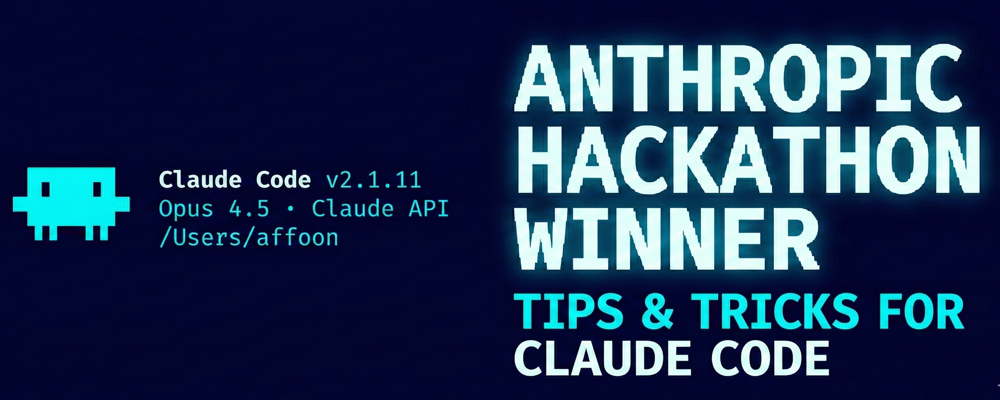
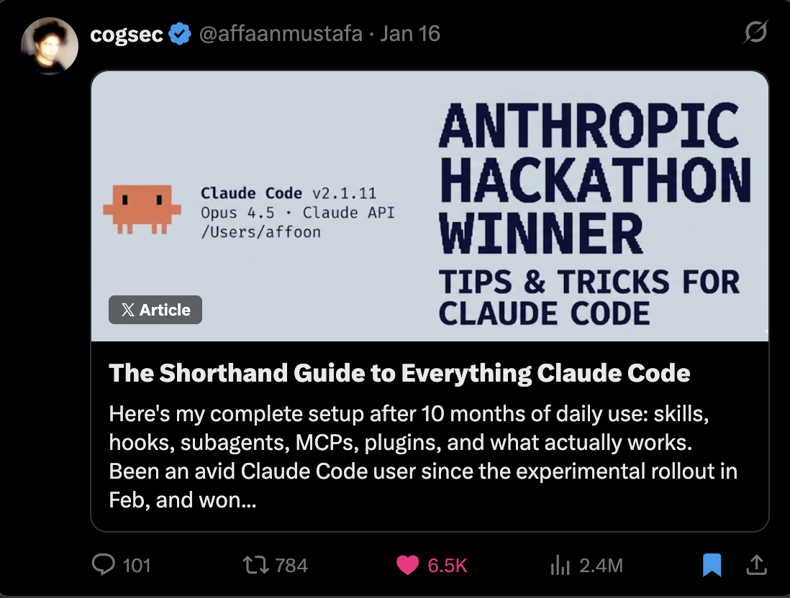
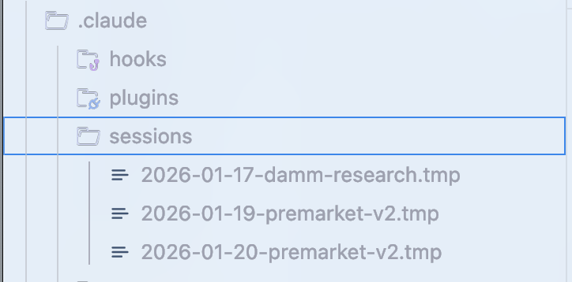
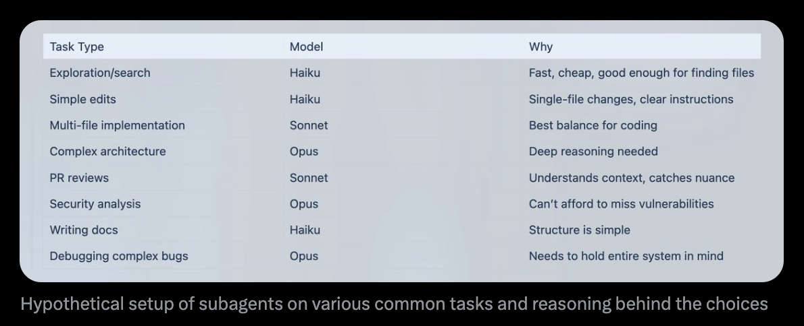
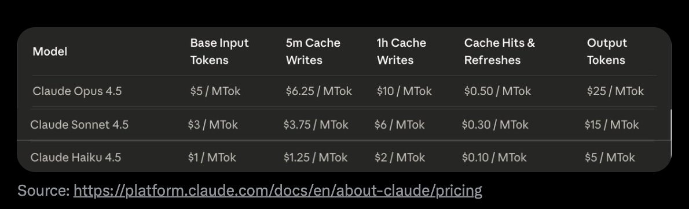
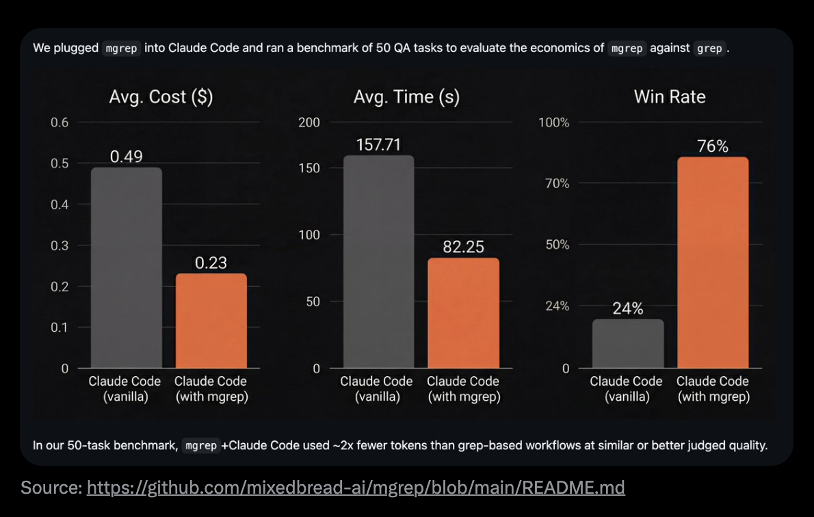
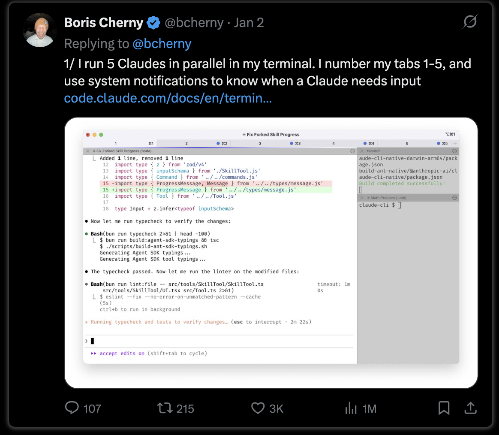
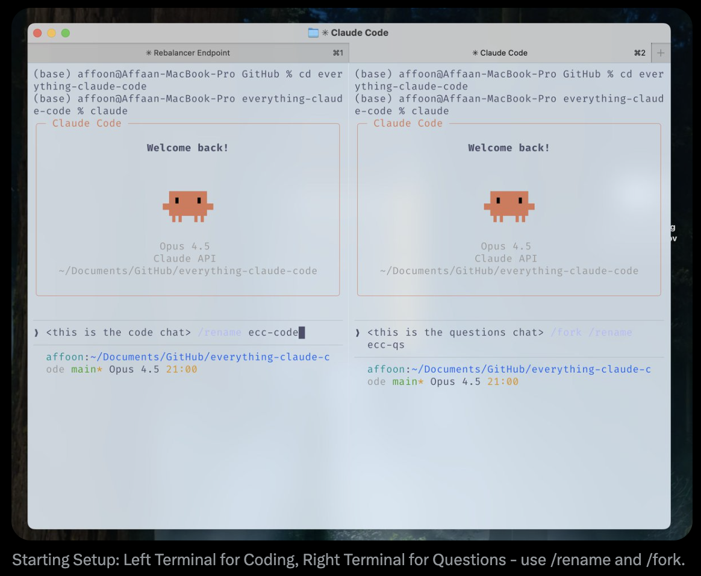
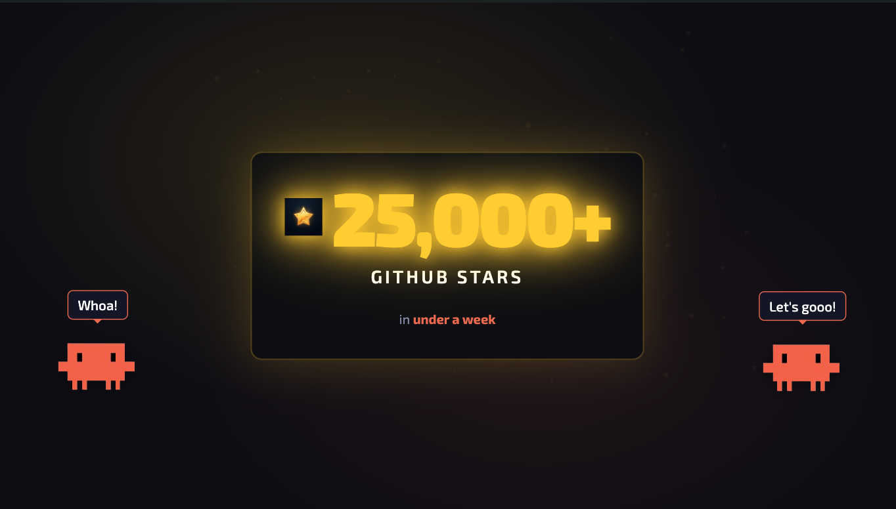

# O guia completo do ECC

[English](the-longform-guide.md) | **Português** | [中文](the-longform-guide.zh-CN.md)



---

> **Pré-requisito**: este guia parte do [guia resumido do ECC](./the-shortform-guide.pt-BR.md). Leia aquele primeiro se você ainda não configurou skills, hooks, subagentes, MCPs e plugins.


*O guia resumido: leia-o primeiro*

No guia resumido, cobri a configuração básica: skills e comandos, hooks,
subagentes, MCPs, plugins e os padrões de configuração que formam a espinha
dorsal de um fluxo eficaz com o Claude Code. Aquele era o guia de configuração e
a infraestrutura de base.

Este guia completo trata das técnicas que separam sessões produtivas de sessões
desperdiçadas. Se você não leu o guia resumido, volte e configure tudo
primeiro. O que vem a seguir supõe que você já tem skills, agentes, hooks e MCPs
configurados e funcionando.

Os temas aqui: economia de tokens, persistência da memória, padrões de
verificação, estratégias de paralelização e o efeito acumulado de construir
fluxos reutilizáveis. São os padrões que refinei em mais de 10 meses de uso
diário e que fazem a diferença entre sofrer com o contexto se deteriorando já na
primeira hora e manter sessões produtivas por horas.

Tudo o que os guias resumido e completo cobrem está no GitHub: `github.com/affaan-m/ECC`

---

## Dicas e truques

### Alguns MCPs são substituíveis e liberam a sua janela de contexto

Em MCPs de controle de versão (GitHub), bancos de dados (Supabase), deploy
(Vercel, Railway) etc., a maioria dessas plataformas já tem CLIs robustas que o
MCP basicamente só embrulha. O MCP é um invólucro agradável, mas tem um custo.

Para que a CLI funcione mais como um MCP sem usar o MCP de fato (e sem a janela
de contexto menor que vem com ele), considere juntar essa funcionalidade em
skills e comandos. Pegue as ferramentas do MCP que facilitam a vida e
transforme-as em comandos.

Exemplo: em vez de deixar o MCP do GitHub carregado o tempo todo, crie um
comando `/gh-pr` que embrulha `gh pr create` com as suas opções preferidas. Em
vez de o MCP do Supabase consumir contexto, crie skills que usam a CLI do
Supabase direto.

Com o carregamento sob demanda, o problema da janela de contexto está quase
resolvido. Mas o uso de tokens e o custo não se resolvem do mesmo jeito. A
abordagem CLI + skills continua sendo um método de otimização de tokens.

---

## O QUE IMPORTA

### Gestão de contexto e memória

Para compartilhar memória entre sessões, o melhor é uma skill ou comando que
resume e registra o progresso, salvando num arquivo `.tmp` na sua pasta
`.claude` e acrescentando a ele até o fim da sessão. No dia seguinte, ele pode
usar isso como contexto e continuar de onde parou. Crie um arquivo novo para
cada sessão, para não misturar contexto antigo no trabalho novo.


*Exemplo de armazenamento de sessões -> <https://github.com/affaan-m/ECC/blob/main/commands/save-session.md#session-file-format>*

O Claude cria um arquivo resumindo o estado atual. Revise, peça ajustes se
precisar e comece do zero. Na conversa nova, basta passar o caminho do arquivo.
Isso é especialmente útil quando você está chegando ao limite de contexto e
precisa continuar um trabalho complexo. Esses arquivos devem conter:
- Quais abordagens funcionaram (de forma verificável, com evidências)
- Quais abordagens foram tentadas e não funcionaram
- Quais abordagens ainda não foram tentadas e o que falta fazer

**Limpando o contexto de forma estratégica:**

Depois de definir o plano e limpar o contexto (hoje é a opção padrão no modo de
plano do Claude Code), você pode trabalhar a partir do plano. Isso ajuda quando
você acumulou muito contexto de exploração que não importa mais para a
execução. Para compactar de forma estratégica, desative a compactação
automática. Compacte à mão em intervalos lógicos ou crie uma skill que faça isso
por você.

**Avançado: injeção dinâmica no prompt de sistema**

Um padrão que aprendi: em vez de colocar tudo só no CLAUDE.md (escopo do
usuário) ou em `.claude/rules/` (escopo do projeto), que carregam em toda
sessão, use flags da CLI para injetar contexto de forma dinâmica.

```bash
claude --system-prompt "$(cat memory.md)"
```

Assim você escolhe com mais precisão que contexto carrega e quando. O conteúdo
do prompt de sistema tem mais autoridade que as mensagens do usuário, que por
sua vez têm mais autoridade que os resultados de ferramentas.

**Configuração prática:**

```bash
# Desenvolvimento do dia a dia
alias claude-dev='claude --system-prompt "$(cat ~/.claude/contexts/dev.md)"'

# Modo de revisão de PR
alias claude-review='claude --system-prompt "$(cat ~/.claude/contexts/review.md)"'

# Modo de pesquisa/exploração
alias claude-research='claude --system-prompt "$(cat ~/.claude/contexts/research.md)"'
```

**Avançado: hooks de persistência da memória**

Existem hooks que pouca gente conhece e que ajudam com a memória:

- **Hook PreCompact**: antes da compactação do contexto, salva o estado
  importante num arquivo
- **Hook Stop (fim da sessão)**: no fim da sessão, grava os aprendizados num
  arquivo
- **Hook SessionStart**: numa sessão nova, carrega o contexto anterior
  automaticamente

Eu criei esses hooks e eles estão no repositório em `github.com/affaan-m/ECC/tree/main/hooks/memory-persistence`

---

### Aprendizado contínuo / memória

Se você teve que repetir um prompt várias vezes e o Claude esbarrou no mesmo
problema ou deu uma resposta que você já ouviu, esses padrões precisam ir para
as skills.

**O problema:** tokens, contexto e tempo desperdiçados.

**A solução:** quando o Claude Code descobre algo que não é trivial (uma técnica
de depuração, um contorno, um padrão específico do projeto), ele salva esse
conhecimento como uma skill nova. Na próxima vez que surgir um problema
parecido, a skill é carregada automaticamente.

Criei uma skill de aprendizado contínuo que faz isso: `github.com/affaan-m/ECC/tree/main/skills/continuous-learning`

**Por que o hook Stop (e não o UserPromptSubmit):**

A decisão de design principal é usar um **hook Stop** em vez do
UserPromptSubmit. O UserPromptSubmit roda em cada mensagem e acrescenta
latência a todo prompt. O Stop roda uma vez no fim da sessão: é leve e não te
atrasa durante a sessão.

---

### Otimização de tokens

**Estratégia principal: arquitetura de subagentes**

Otimize as ferramentas que você usa e monte uma arquitetura de subagentes que
delegue sempre ao modelo mais barato que dê conta da tarefa.

**Referência rápida para escolher o modelo:**


*Configuração hipotética de subagentes para várias tarefas comuns e o motivo de cada escolha*

| Tipo de tarefa                  | Modelo | Por quê                                          |
| ------------------------------- | ------ | ------------------------------------------------ |
| Exploração/busca                | Haiku  | Rápido, barato, bom o bastante para achar arquivos |
| Edições simples                 | Haiku  | Mudanças num só arquivo, instruções claras       |
| Implementação em vários arquivos | Sonnet | O melhor equilíbrio para programar               |
| Arquitetura complexa            | Opus   | Exige raciocínio profundo                        |
| Revisão de PRs                  | Sonnet | Entende o contexto, pega nuances                 |
| Análise de segurança            | Opus   | Não dá para deixar passar vulnerabilidades       |
| Escrever documentação           | Haiku  | A estrutura é simples                            |
| Depurar bugs complexos          | Opus   | Precisa manter o sistema inteiro em mente        |

Use o Sonnet por padrão em 90% das tarefas de código. Suba para o Opus quando a
primeira tentativa falhar, a tarefa passar de 5 arquivos, envolver decisões de
arquitetura ou código crítico para a segurança.

**Referência de preços:**


*Fonte: <https://platform.claude.com/docs/en/about-claude/pricing>*

**Otimizações específicas de ferramentas:**

Troque o grep pelo mgrep: em média, ~50% menos tokens que o grep ou o ripgrep
tradicionais:


*No nosso benchmark de 50 tarefas, mgrep + Claude Code usou ~2x menos tokens que os fluxos baseados em grep, com qualidade avaliada igual ou melhor. Fonte: mgrep, de @mixedbread-ai*

**Vantagens de um código modular:**

Um código mais modular, com os arquivos principais na casa das centenas de
linhas e não dos milhares, ajuda tanto a reduzir o custo em tokens quanto a
acertar a tarefa logo na primeira tentativa.

---

### Ciclos de verificação e evals

**Fluxo de benchmark:**

Compare pedir a mesma coisa com e sem uma skill e veja a diferença no
resultado:

Bifurque a conversa, abra um worktree novo numa delas sem a skill, gere um diff
no fim e veja o que foi registrado.

**Tipos de padrão de eval:**

- **Evals com checkpoints**: defina checkpoints explícitos, verifique contra
  critérios definidos e corrija antes de seguir
- **Evals contínuos**: rode a cada N minutos ou depois de mudanças grandes, com a
  suíte de testes completa + lint

**Métricas principais:**

```
pass@k: pelo menos UMA de k tentativas dá certo
        k=1: 70%  k=3: 91%  k=5: 97%

pass^k: TODAS as k tentativas precisam dar certo
        k=1: 70%  k=3: 34%  k=5: 17%
```

Use **pass@k** quando você só precisa que funcione. Use **pass^k** quando a
consistência é essencial.

---

## PARALELIZAÇÃO

Ao bifurcar conversas num ambiente com vários Claudes no terminal, garanta que
o escopo das ações esteja bem definido tanto no fork quanto na conversa
original. Procure ter o mínimo de sobreposição nas mudanças de código.

**O meu padrão preferido:**

O chat principal para mudanças no código; forks para perguntas sobre o código e
o estado atual dele, ou para pesquisar serviços externos.

**Sobre números arbitrários de terminais:**


*Boris (Anthropic) sobre rodar várias instâncias do Claude*

O Boris tem dicas de paralelização. Ele sugeriu coisas como rodar 5 instâncias
do Claude localmente e 5 na nuvem. Eu não recomendo definir quantidades
arbitrárias de terminais. Um terminal novo deve vir de uma necessidade real.

O seu objetivo deve ser: **quanto você consegue fazer com o mínimo de
paralelização necessário.**

**Git worktrees para instâncias em paralelo:**

```bash
# Crie worktrees para trabalhar em paralelo
git worktree add ../project-feature-a feature-a
git worktree add ../project-feature-b feature-b
git worktree add ../project-refactor refactor-branch

# Cada worktree ganha a sua própria instância do Claude
cd ../project-feature-a && claude
```

SE você for aumentar o número de instâncias E tiver várias instâncias do Claude
trabalhando em código que se sobrepõe, é indispensável usar git worktrees e ter
um plano muito bem definido para cada uma. Use `/rename <nome aqui>` para dar
nome a todos os seus chats.


*Configuração inicial: terminal da esquerda para programar, da direita para perguntas; use /rename e /fork*

**O método cascata:**

Ao rodar várias instâncias do Claude Code, organize no padrão "cascata":

- Abra tarefas novas em abas novas, à direita
- Percorra da esquerda para a direita, da mais antiga para a mais nova
- Foque em no máximo 3 ou 4 tarefas por vez

---

## PREPARAÇÃO DO TERRENO

**O padrão de início com duas instâncias:**

Para organizar o meu próprio trabalho, gosto de começar um repositório vazio com
2 instâncias do Claude abertas.

**Instância 1: agente de estrutura**
- Monta a estrutura e a base
- Cria a estrutura do projeto
- Configura tudo (CLAUDE.md, regras, agentes)

**Instância 2: agente de pesquisa aprofundada**
- Conecta-se a todos os seus serviços e à busca na web
- Cria o PRD detalhado
- Cria diagramas de arquitetura em mermaid
- Reúne as referências com trechos reais da documentação

**O padrão llms.txt:**

Quando existe, dá para encontrar um `llms.txt` em muitas documentações
acessando `/llms.txt` depois de chegar à página da documentação. Isso dá uma
versão limpa da documentação, otimizada para LLMs.

**Filosofia: construa padrões reutilizáveis**

De @omarsar0: "No começo, gastei tempo construindo fluxos/padrões reutilizáveis.
Foi trabalhoso, mas teve um efeito acumulado enorme à medida que os modelos e
os ambientes de agentes melhoraram."

**Onde investir:**

- Subagentes
- Skills
- Comandos
- Padrões de planejamento
- Ferramentas MCP
- Padrões de engenharia de contexto

---

## Boas práticas para agentes e subagentes

**O problema de contexto dos subagentes:**

Subagentes existem para economizar contexto, devolvendo resumos em vez de
despejar tudo. Mas o orquestrador tem um contexto semântico que o subagente não
tem. O subagente só conhece a pergunta literal, não o PROPÓSITO por trás do
pedido.

**Padrão de recuperação iterativa:**

1. O orquestrador avalia cada retorno do subagente
2. Faz perguntas de acompanhamento antes de aceitar
3. O subagente volta à fonte, consegue as respostas e retorna
4. Repete até ser suficiente (no máximo 3 ciclos)

**Chave:** passe o objetivo como contexto, não só a pergunta.

**Orquestrador com fases sequenciais:**

```markdown
Fase 1: PESQUISA (use o agente Explore) → research-summary.md
Fase 2: PLANO (use o agente planner) → plan.md
Fase 3: IMPLEMENTAÇÃO (use o agente tdd-guide) → mudanças no código
Fase 4: REVISÃO (use o agente code-reviewer) → review-comments.md
Fase 5: VERIFICAÇÃO (use o build-error-resolver se precisar) → pronto ou volta ao início
```

**Regras principais:**

1. Cada agente recebe UMA entrada clara e produz UMA saída clara
2. As saídas viram entradas da fase seguinte
3. Nunca pule fases
4. Use `/clear` entre os agentes
5. Guarde as saídas intermediárias em arquivos

---

## EXTRAS / NADA CRÍTICO, SÓ DICAS DIVERTIDAS

### Barra de status personalizada

Você pode configurá-la com `/statusline`: o Claude vai dizer que você não tem
uma, oferecer para configurar e perguntar o que você quer nela.

Veja também: ccstatusline (projeto da comunidade para barras de status
personalizadas no Claude Code)

### Transcrição de voz

Fale com o Claude Code usando a voz. Para muita gente é mais rápido que digitar.

- superwhisper, MacWhisper no Mac
- Mesmo com erros de transcrição, o Claude entende a intenção

### Aliases de terminal

```bash
alias c='claude'
alias gb='github'
alias co='code'
alias q='cd ~/Desktop/projects'
```

---

## Marco


*Mais de 25.000 estrelas no GitHub em menos de uma semana*

---

## Recursos

**Orquestração de agentes:**

- claude-flow: plataforma de orquestração corporativa feita pela comunidade, com
  mais de 54 agentes especializados

**Memória que se aprimora sozinha:**

- Veja `skills/admin/continuous-learning/` neste repositório
- rlancemartin.github.io/2025/12/01/claude_diary/: padrão de reflexão sobre a
  sessão

**Referência de prompts de sistema:**

- system-prompts-and-models-of-ai-tools: coleção da comunidade com prompts de
  sistema de ferramentas de IA (mais de 110 mil estrelas)

**Oficial:**

- Anthropic Academy: anthropic.skilljar.com

---

## Referências

- [Anthropic: Demystifying evals for AI agents](https://www.anthropic.com/engineering/demystifying-evals-for-ai-agents)
- [YK: 32 Claude Code Tips](https://agenticcoding.substack.com/p/32-claude-code-tips-from-basics-to)
- [RLanceMartin: Session Reflection Pattern](https://rlancemartin.github.io/2025/12/01/claude_diary/)
- @PerceptualPeak: Sub-Agent Context Negotiation
- @menhguin: Agent Abstractions Tierlist
- @omarsar0: Compound Effects Philosophy

---

*Tudo o que os dois guias cobrem está no GitHub, em [ECC](https://github.com/affaan-m/ECC)*
