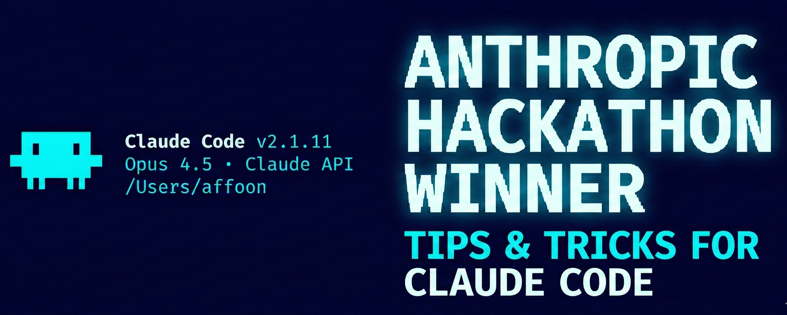
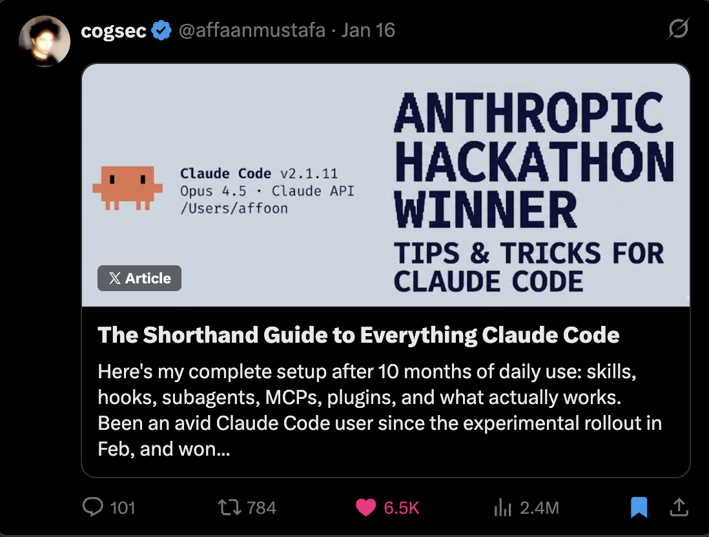
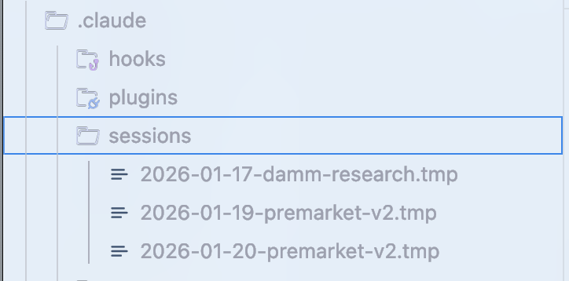
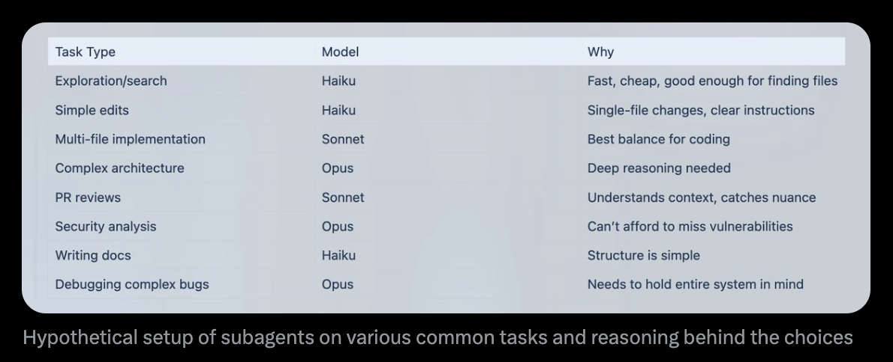
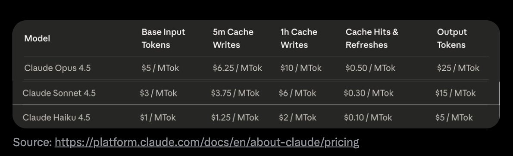
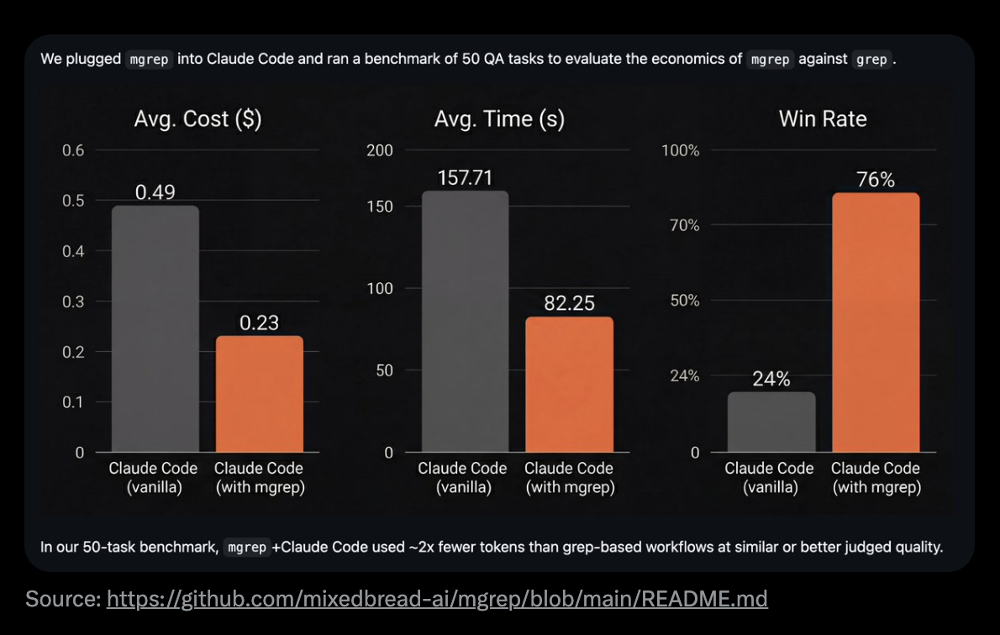
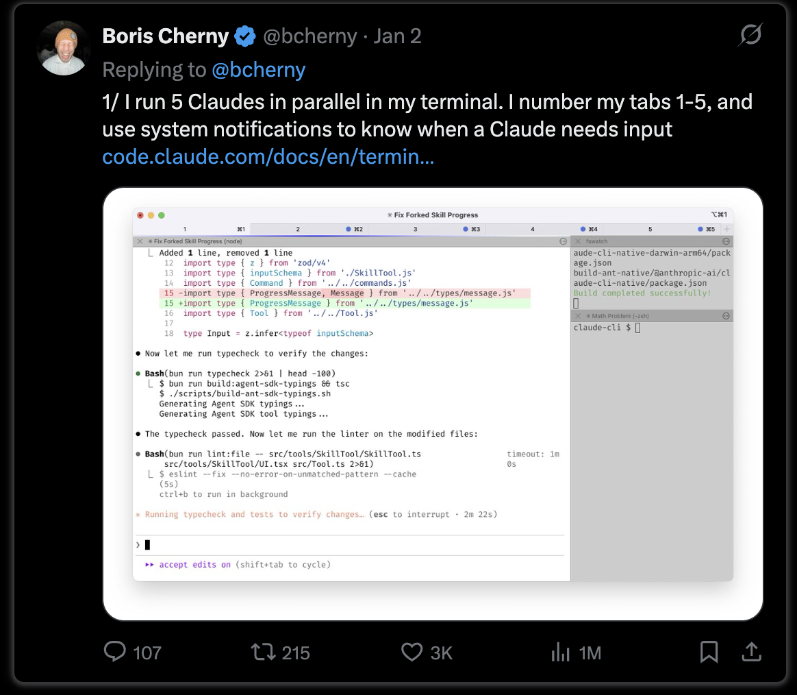
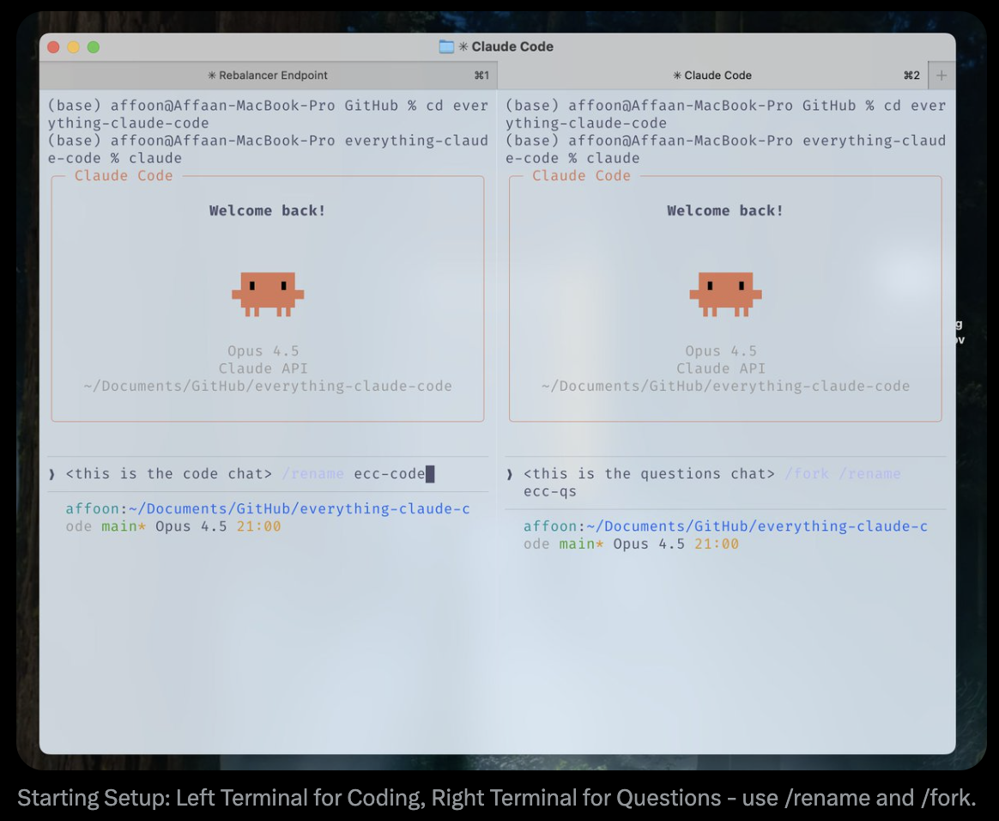

# ECC 完整指南

[English](the-longform-guide.md) | [Português](the-longform-guide.pt-BR.md) | **中文**



---

> **前提**：本指南建立在 [ECC 简明指南](./the-shortform-guide.zh-CN.md) 的基础上。如果你还没有配置技能、钩子、子代理、MCP 和插件，请先读那篇。


*简明指南——请先阅读*

在简明指南中，我介绍了基础配置：技能和命令、钩子、子代理、MCP、插件，以及构成高效 Claude Code
工作流骨架的配置模式。那是配置指南和基础设施。

这篇完整指南讲的是区分高效会话和浪费会话的技巧。如果你还没读简明指南，请先回去把配置弄好。下面的
内容都假定你已经配置好技能、代理、钩子和 MCP，并且它们都能正常工作。

本文的主题：token 经济学、记忆持久化、验证模式、并行策略，以及构建可复用工作流带来的复利效应。
这些是我在 10 个多月的日常使用中打磨出来的模式，它们决定了你是在第一个小时就被上下文腐化困扰，
还是能连续几个小时保持高效。

简明指南和完整指南涉及的所有内容都在 GitHub 上：`github.com/affaan-m/ECC`

---

## 技巧与窍门

### 有些 MCP 可以替换，还能腾出上下文窗口

对于版本控制（GitHub）、数据库（Supabase）、部署（Vercel、Railway）等 MCP——这些平台大多已经
有强大的 CLI，MCP 基本上只是把它们包了一层。MCP 是个不错的包装，但有代价。

想让 CLI 用起来更像 MCP、又不真正使用 MCP（以及随之缩小的上下文窗口），可以考虑把这些功能打包成
技能和命令。把 MCP 提供的那些好用的工具拆出来，变成命令。

示例：不要一直加载 GitHub MCP，而是创建一个 `/gh-pr` 命令，用你偏好的选项包装 `gh pr create`。
不要让 Supabase MCP 吃掉上下文，而是创建直接使用 Supabase CLI 的技能。

有了延迟加载，上下文窗口的问题基本解决了。但 token 用量和成本并没有以同样方式解决。CLI + 技能的
做法仍然是一种 token 优化方法。

---

## 重要内容

### 上下文与记忆管理

要在会话之间共享记忆，最好的办法是用一个技能或命令汇总并记录进度，保存到 `.claude` 文件夹里的
`.tmp` 文件，并在会话结束前不断追加。第二天就可以把它当作上下文，从上次中断处继续。每个会话
创建一个新文件，免得把旧的上下文混进新的工作。


*会话存储示例 -> <https://github.com/affaan-m/ECC/blob/main/commands/save-session.md#session-file-format>*

Claude 会创建一个总结当前状态的文件。检查它，需要时让它修改，然后重新开始。在新对话中，只要提供
文件路径即可。当你快到上下文上限、又需要继续复杂的工作时，这特别有用。这些文件应包含：
- 哪些方法有效（有证据可以验证）
- 哪些方法试过但不行
- 哪些方法还没试过，以及还剩什么要做

**有策略地清空上下文：**

定好计划并清空上下文后（现在这是 Claude Code 计划模式的默认选项），你就可以按计划工作。当你积累
了很多与执行无关的探索性上下文时，这很有用。要有策略地压缩，就关闭自动压缩，在合乎逻辑的节点
手动压缩，或者写一个技能替你做。

**进阶：动态注入系统提示词**

我学到的一个模式：不要只把所有内容放进每次会话都会加载的 CLAUDE.md（用户范围）或
`.claude/rules/`（项目范围），而是用 CLI 参数动态注入上下文。

```bash
claude --system-prompt "$(cat memory.md)"
```

这样你可以更精确地控制什么时候加载什么上下文。系统提示词的权威高于用户消息，用户消息的权威又
高于工具结果。

**实用配置：**

```bash
# 日常开发
alias claude-dev='claude --system-prompt "$(cat ~/.claude/contexts/dev.md)"'

# PR 评审模式
alias claude-review='claude --system-prompt "$(cat ~/.claude/contexts/review.md)"'

# 研究/探索模式
alias claude-research='claude --system-prompt "$(cat ~/.claude/contexts/research.md)"'
```

**进阶：记忆持久化钩子**

有些钩子很多人不知道，但对记忆很有帮助：

- **PreCompact 钩子**：在上下文压缩之前，把重要状态保存到文件
- **Stop 钩子（会话结束）**：会话结束时，把学到的东西写入文件
- **SessionStart 钩子**：新会话开始时，自动加载之前的上下文

这些钩子我已经写好了，放在仓库的 `github.com/affaan-m/ECC/tree/main/hooks/memory-persistence`

---

### 持续学习 / 记忆

如果你不得不多次重复同一个提示词，而 Claude 碰到了同样的问题，或者给出了你听过的回答——这些模式
都应该追加到技能里。

**问题：**浪费 token、浪费上下文、浪费时间。

**解决办法：**当 Claude Code 发现不平凡的东西——一种调试技巧、一个变通办法、某个项目特有的模式——
它会把这些知识保存为新技能。下次遇到类似问题时，这个技能会被自动加载。

我写了一个做这件事的持续学习技能：`github.com/affaan-m/ECC/tree/main/skills/continuous-learning`

**为什么用 Stop 钩子（而不是 UserPromptSubmit）：**

关键的设计决策是使用 **Stop 钩子**而不是 UserPromptSubmit。UserPromptSubmit 在每条消息上都会运行，
给每个提示词增加延迟。Stop 只在会话结束时运行一次——很轻量，不会在会话中拖慢你。

---

### Token 优化

**主要策略：子代理架构**

优化你使用的工具，并设计子代理架构，把任务委派给足以完成任务的最便宜的模型。

**模型选择速查：**


*针对各种常见任务的子代理假设配置，以及每个选择的理由*

| 任务类型       | 模型   | 原因                         |
| -------------- | ------ | ---------------------------- |
| 探索/搜索      | Haiku  | 快、便宜，找文件足够用       |
| 简单编辑       | Haiku  | 单文件改动，指令明确         |
| 多文件实现     | Sonnet | 编码的最佳平衡               |
| 复杂架构       | Opus   | 需要深度推理                 |
| PR 评审        | Sonnet | 理解上下文，能抓住细节       |
| 安全分析       | Opus   | 不能放过任何漏洞             |
| 写文档         | Haiku  | 结构简单                     |
| 调试复杂缺陷   | Opus   | 需要在脑中装下整个系统       |

90% 的编码任务默认用 Sonnet。当第一次尝试失败、任务涉及 5 个以上文件、涉及架构决策或安全关键代码
时，升级到 Opus。

**价格参考：**


*来源：<https://platform.claude.com/docs/en/about-claude/pricing>*

**针对工具的优化：**

用 mgrep 替代 grep——与传统的 grep 或 ripgrep 相比，平均减少约 50% 的 token：


*在我们 50 个任务的基准测试中，mgrep + Claude Code 用的 token 比基于 grep 的工作流少约一半，评估质量相当或更好。来源：@mixedbread-ai 的 mgrep*

**模块化代码库的好处：**

代码库更模块化、主要文件只有几百行而不是几千行，既有助于降低 token 成本，也更容易第一次就把任务
做对。

---

### 验证循环与评测

**基准测试流程：**

对比有无某个技能时提出同样请求的结果差异：

分叉对话，在其中一个不带该技能的分支里新建 worktree，最后生成 diff，看看记录了什么。

**评测模式类型：**

- **基于检查点的评测**：设置明确的检查点，按既定标准验证，修复后再继续
- **持续评测**：每 N 分钟或重大改动后运行一次，跑完整测试套件 + lint

**关键指标：**

```
pass@k：k 次尝试中至少有一次成功
        k=1: 70%  k=3: 91%  k=5: 97%

pass^k：k 次尝试必须全部成功
        k=1: 70%  k=3: 34%  k=5: 17%
```

只需要它能跑通时用 **pass@k**；一致性至关重要时用 **pass^k**。

---

## 并行化

在多个 Claude 终端的环境中分叉对话时，要确保分叉和原对话中的操作范围都定义清楚，代码改动尽量
不要重叠。

**我偏好的模式：**

主对话负责改代码，分叉用来询问代码库及其现状，或者研究外部服务。

**关于随意设定的终端数量：**


*Boris（Anthropic）谈运行多个 Claude 实例*

Boris 分享过一些并行化的技巧，比如本地运行 5 个 Claude 实例、云端再运行 5 个。我不建议随意设定
终端数量。增加一个终端应该出于真正的需要。

你的目标应该是：**用最少的必要并行度完成尽可能多的事。**

**为并行实例使用 git worktree：**

```bash
# 为并行工作创建 worktree
git worktree add ../project-feature-a feature-a
git worktree add ../project-feature-b feature-b
git worktree add ../project-refactor refactor-branch

# 每个 worktree 各自运行一个 Claude 实例
cd ../project-feature-a && claude
```

如果你要扩展实例数量，并且有多个 Claude 实例在处理相互重叠的代码，那就必须使用 git worktree，
并为每个实例制定非常清晰的计划。用 `/rename <名称>` 给所有对话命名。


*起步配置：左侧终端写代码，右侧终端提问——使用 /rename 和 /fork*

**瀑布法：**

运行多个 Claude Code 实例时，按"瀑布"模式组织：

- 在右侧新标签页中打开新任务
- 从左到右、从旧到新依次处理
- 同时最多专注 3 到 4 个任务

---

## 打基础

**双实例起步模式：**

管理自己的工作流时，我喜欢在一个空仓库里同时打开 2 个 Claude 实例。

**实例 1：搭架子的代理**
- 搭好脚手架和基础
- 创建项目结构
- 配置 CLAUDE.md、规则、代理等

**实例 2：深度研究代理**
- 连接你所有的服务和网页搜索
- 编写详细的 PRD
- 绘制 mermaid 架构图
- 整理附有真实文档摘录的参考资料

**llms.txt 模式：**

如果有的话，进入很多文档网站后访问 `/llms.txt` 就能找到 `llms.txt`。它提供一份干净的、为 LLM
优化过的文档版本。

**理念：构建可复用的模式**

来自 @omarsar0："早期我花时间构建可复用的工作流/模式。做起来很繁琐，但随着模型和智能体环境的
进步，它带来了惊人的复利效应。"

**值得投入的地方：**

- 子代理
- 技能
- 命令
- 规划模式
- MCP 工具
- 上下文工程模式

---

## 代理与子代理的最佳实践

**子代理的上下文问题：**

子代理的存在是为了节省上下文——返回摘要，而不是把所有东西都倒出来。但编排者拥有子代理所没有的
语义上下文。子代理只知道字面上的问题，不知道请求背后的**目的**。

**迭代检索模式：**

1. 编排者评估子代理的每一次返回
2. 在接受之前提出追问
3. 子代理回到源头，拿到答案后返回
4. 循环直到足够（最多 3 轮）

**关键：**传递目标上下文，而不只是问题本身。

**按顺序分阶段的编排者：**

```markdown
阶段 1：研究（使用 Explore 代理）→ research-summary.md
阶段 2：计划（使用 planner 代理）→ plan.md
阶段 3：实现（使用 tdd-guide 代理）→ 代码改动
阶段 4：评审（使用 code-reviewer 代理）→ review-comments.md
阶段 5：验证（需要时使用 build-error-resolver）→ 完成或回到开头
```

**关键规则：**

1. 每个代理只接收**一个**清晰的输入，只产出**一个**清晰的输出
2. 输出成为下一阶段的输入
3. 永远不要跳过阶段
4. 在代理之间使用 `/clear`
5. 把中间产出保存在文件中

---

## 趣味内容 / 不重要，只是好玩的技巧

### 自定义状态栏

可以用 `/statusline` 设置——Claude 会告诉你还没有状态栏，提出帮你配置，并问你想在里面显示什么。

另见：ccstatusline（用于自定义 Claude Code 状态栏的社区项目）

### 语音转写

用语音和 Claude Code 对话。对很多人来说比打字快。

- Mac 上的 superwhisper、MacWhisper
- 即使转写有错，Claude 也能理解你的意图

### 终端别名

```bash
alias c='claude'
alias gb='github'
alias co='code'
alias q='cd ~/Desktop/projects'
```

---

## 里程碑


*不到一周获得 25,000+ GitHub 星标*

---

## 资源

**智能体编排：**

- claude-flow——社区打造的企业级编排平台，拥有 54 个以上的专用代理

**自我改进的记忆：**

- 见本仓库的 `skills/admin/continuous-learning/`
- rlancemartin.github.io/2025/12/01/claude_diary/——会话反思模式

**系统提示词参考：**

- system-prompts-and-models-of-ai-tools——社区收集的 AI 工具系统提示词（11 万+ 星标）

**官方：**

- Anthropic Academy：anthropic.skilljar.com

---

## 参考资料

- [Anthropic: Demystifying evals for AI agents](https://www.anthropic.com/engineering/demystifying-evals-for-ai-agents)
- [YK: 32 Claude Code Tips](https://agenticcoding.substack.com/p/32-claude-code-tips-from-basics-to)
- [RLanceMartin: Session Reflection Pattern](https://rlancemartin.github.io/2025/12/01/claude_diary/)
- @PerceptualPeak: Sub-Agent Context Negotiation
- @menhguin: Agent Abstractions Tierlist
- @omarsar0: Compound Effects Philosophy

---

*两篇指南涉及的所有内容都可以在 GitHub 的 [ECC](https://github.com/affaan-m/ECC) 上找到*
