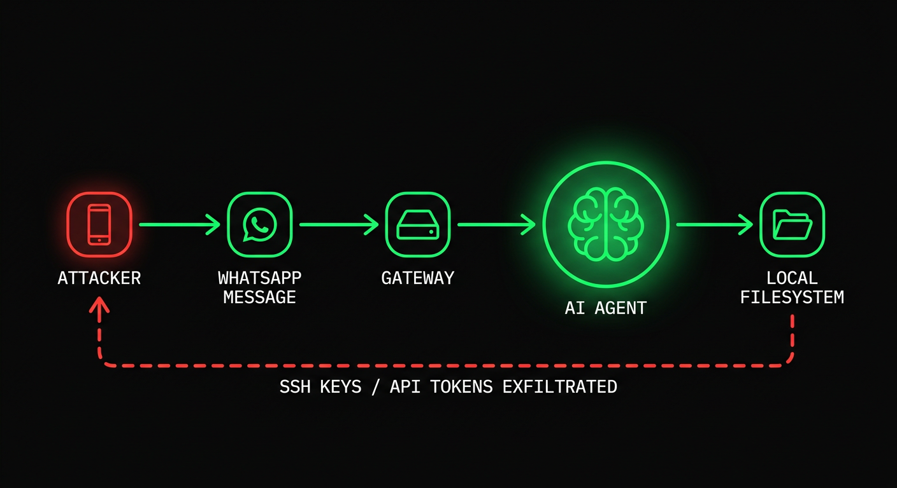
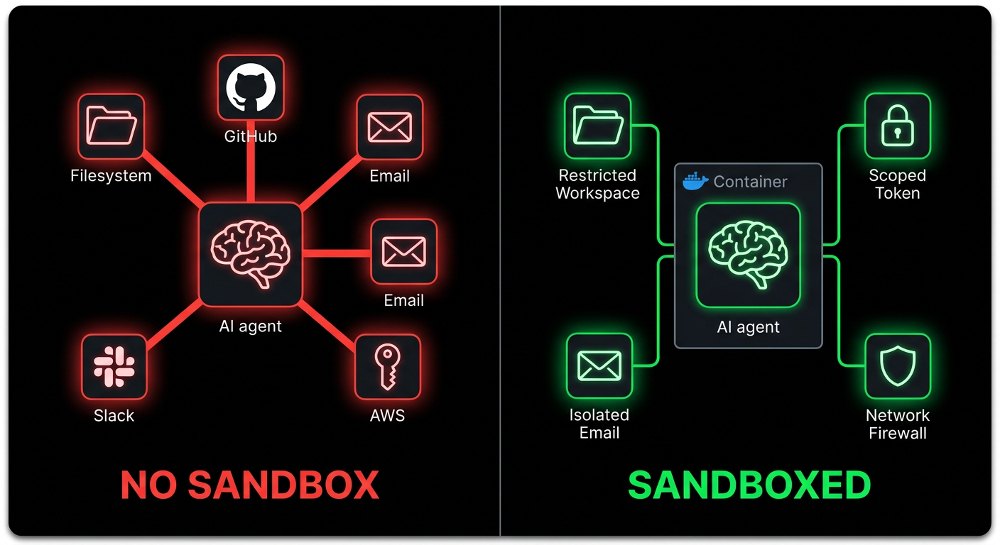
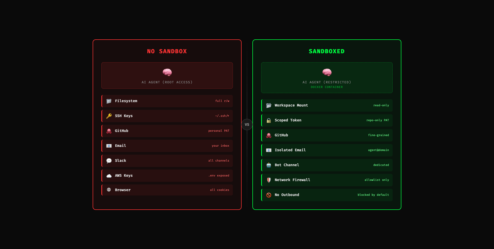
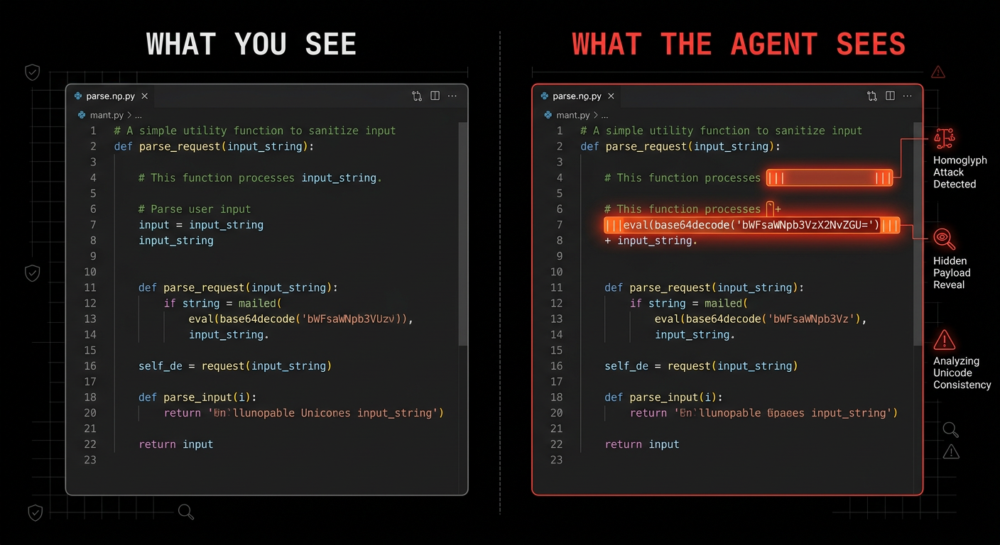
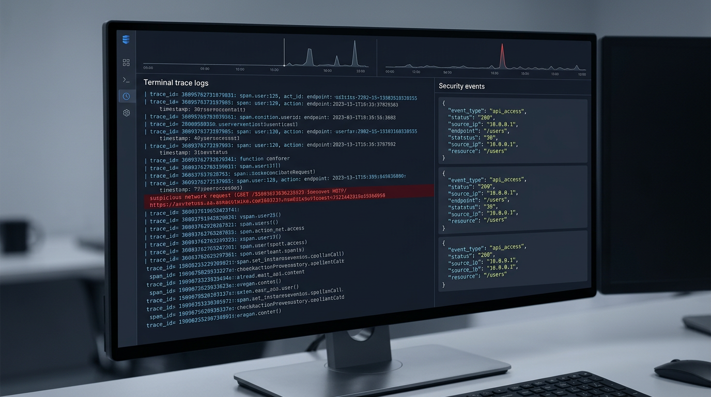
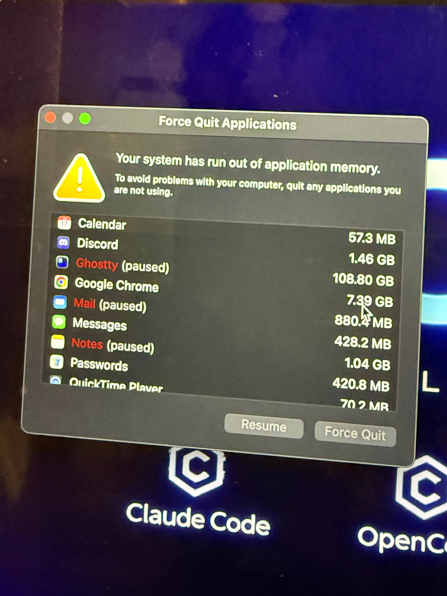

# O guia resumido de segurança para agentes

[English](the-security-guide.md) | **Português** | [中文](the-security-guide.zh-CN.md)

_ecc / pesquisa / segurança_

---

Faz um tempo desde o meu último artigo. Passei esse período construindo o
ecossistema de ferramentas de desenvolvimento do ECC. Um dos poucos temas em
alta, mas importantes, nesse período foi a segurança de agentes.

A adoção em massa de agentes de código aberto chegou. O OpenClaw e outros rodam
soltos pelo seu computador. Ambientes de execução contínua como o Claude Code e
o Codex (usando o ECC) aumentam a superfície de ataque; e em 25 de fevereiro de
2026 a Check Point Research publicou uma divulgação sobre o Claude Code que
deveria ter encerrado de vez a fase "isso pode acontecer, mas não vai / é
exagero". Com as ferramentas atingindo massa crítica, a gravidade dos exploits
se multiplica.

Uma falha, a CVE-2025-59536 (CVSS 8.7), permitia que código contido no projeto
rodasse antes de o usuário aceitar o diálogo de confiança. Outra, a
CVE-2026-21852, permitia redirecionar o tráfego da API por um
`ANTHROPIC_BASE_URL` controlado pelo atacante, vazando a chave de API antes de
a confiança ser confirmada. Bastava clonar o repositório e abrir a ferramenta.

As ferramentas em que confiamos também são as ferramentas visadas. Essa é a
mudança. Prompt injection não é mais uma falha boba do modelo nem uma captura de
tela engraçada de jailbreak (embora eu tenha uma engraçada para mostrar mais
abaixo); num sistema com agentes, ele pode virar execução de shell, exposição
de segredos, abuso de workflow ou movimento lateral silencioso.

## Vetores e superfícies de ataque

Vetores de ataque são, basicamente, qualquer ponto de entrada de interação.
Quanto mais serviços o seu agente acessa, mais risco você acumula. Informação
de fora entregue ao agente aumenta o risco.

### A cadeia de ataque e os nós/componentes envolvidos



Por exemplo: o meu agente está ligado ao WhatsApp por uma camada de gateway. Um
adversário sabe o seu número de WhatsApp. Ele tenta um prompt injection usando
um jailbreak conhecido, enchendo o chat de tentativas. O agente lê a mensagem e
a trata como instrução. Ele executa uma resposta que revela informações
privadas. Se o seu agente tem acesso root, acesso amplo ao sistema de arquivos
ou credenciais úteis carregadas, você foi comprometido.

Até esses vídeos do jailbreak do Good Rudi de que o pessoal ri (é engraçado,
não vou mentir) apontam para a mesma classe de problema: tentativas repetidas
até uma revelação sensível. Na superfície é engraçado, mas a falha por trás é
séria; afinal, a coisa foi feita para crianças. Extrapole um pouco e você logo
entende por que isso pode ser catastrófico. O mesmo padrão vai muito mais longe
quando o modelo está ligado a ferramentas e permissões reais.

[Vídeo: o exploit do Bad Rudi](./assets/images/security/badrudi-exploit.mp4): o Good Rudi (personagem animado de IA do Grok para crianças) é explorado com um jailbreak depois de várias tentativas, até revelar informações sensíveis. É um exemplo engraçado, mas as possibilidades vão muito além.

O WhatsApp é só um exemplo. Anexos de e-mail são um vetor enorme. Um atacante
manda um PDF com um prompt embutido; o seu agente lê o anexo como parte do
trabalho e, de repente, um texto que deveria ser só dado útil virou instrução
maliciosa. Capturas de tela e digitalizações são igualmente ruins se você faz
OCR nelas. O próprio trabalho da Anthropic sobre prompt injection cita texto
escondido e imagens manipuladas como material de ataque real.

As revisões de PR no GitHub são outro alvo. Instruções maliciosas podem estar em
comentários escondidos no diff, no corpo de issues, em documentos linkados, na
saída de ferramentas e até num contexto de revisão "útil". Se você tem bots
configurados no repositório (agentes de revisão de código, Greptile, Cubic
etc.) ou usa automações locais (OpenClaw, Claude Code, Codex, agente de código
do Copilot, o que for), com pouca supervisão e muita autonomia para revisar
PRs, você aumenta o risco de sofrer prompt injection E de afetar com o exploit
todo usuário que depende do seu repositório.

O próprio design do agente de código do GitHub é uma admissão discreta desse
modelo de ameaça. Só usuários com acesso de escrita podem atribuir trabalho ao
agente. Comentários de quem tem menos privilégio não são mostrados a ele.
Caracteres escondidos são filtrados. Os pushes são limitados. Os workflows
ainda exigem que uma pessoa clique em **Approve and run workflows**. Se eles te
protegem com essas precauções sem você nem perceber, o que acontece quando você
administra e hospeda os seus próprios serviços?

Os servidores MCP são outra camada inteira. Eles podem ser vulneráveis por
acidente, maliciosos de propósito ou simplesmente receber confiança demais do
cliente. Uma ferramenta pode exfiltrar dados enquanto parece fornecer contexto
ou devolver a informação que a chamada deveria devolver. A OWASP agora tem um
MCP Top 10 exatamente por isso: envenenamento de ferramentas, prompt injection
via conteúdo de contexto, injeção de comandos, servidores MCP paralelos,
exposição de segredos. Quando o seu modelo trata descrições de ferramentas,
schemas e saídas de ferramentas como contexto confiável, a própria cadeia de
ferramentas vira parte da sua superfície de ataque.

Você provavelmente já está vendo quão fundo os efeitos de rede podem ir. Quando
a superfície de risco é grande e um elo da corrente é infectado, ele contamina
os elos abaixo. Vulnerabilidades se espalham como doenças infecciosas, porque os
agentes ficam no meio de vários caminhos confiáveis ao mesmo tempo.

A "tríade letal" de Simon Willison ainda é o jeito mais limpo de pensar nisso:
dados privados, conteúdo não confiável e comunicação externa. Quando os três
vivem no mesmo ambiente de execução, o prompt injection deixa de ser engraçado e
vira exfiltração de dados.

## As CVEs do Claude Code (fevereiro de 2026)

A Check Point Research publicou as descobertas sobre o Claude Code em 25 de
fevereiro de 2026. Os problemas foram reportados entre julho e dezembro de 2025
e corrigidos antes da publicação.

O importante não são só os IDs das CVEs e o post-mortem. É o que isso revela
sobre o que de fato acontece na camada de execução dos nossos ambientes.

> **Tal Be'ery** [@TalBeerySec](https://x.com/TalBeerySec) · 26 de fev.
>
> Sequestrando usuários do Claude Code com arquivos de configuração envenenados com ações de hooks maliciosas.
>
> Ótima pesquisa de [@CheckPointSW](https://x.com/CheckPointSW) [@Od3dV](https://x.com/Od3dV) - Aviv Donenfeld
>
> _Citando [@Od3dV](https://x.com/Od3dV) · 26 de fev.:_
> _Hackeei o Claude Code! No fim, "agêntico" é só um jeito novo e chique de conseguir um shell. Consegui RCE completo e sequestrei chaves de API da organização. CVE-2025-59536 | CVE-2026-21852_
> [research.checkpoint.com](https://research.checkpoint.com/2026/rce-and-api-token-exfiltration-through-claude-code-project-files-cve-2025-59536/)

**CVE-2025-59536.** Código contido no projeto podia rodar antes de o diálogo de
confiança ser aceito. O NVD e o aviso do GitHub ligam isso às versões
anteriores à `1.0.111`.

**CVE-2026-21852.** Um projeto controlado por um atacante podia sobrescrever o
`ANTHROPIC_BASE_URL`, redirecionar o tráfego da API e vazar a chave de API antes
da confirmação de confiança. O NVD diz que quem atualiza à mão deve estar na
`2.0.65` ou mais nova.

**Abuso do consentimento de MCP.** A Check Point também mostrou como a
configuração de MCP e as definições controladas pelo repositório podiam aprovar
automaticamente os servidores MCP do projeto antes de o usuário confiar de
verdade na pasta.

Fica claro como a configuração do projeto, os hooks, as definições de MCP e as
variáveis de ambiente agora fazem parte da superfície de execução.

A própria documentação da Anthropic reflete essa realidade. As configurações do
projeto ficam em `.claude/`. Os servidores MCP do projeto ficam em `.mcp.json`.
Eles são compartilhados pelo controle de versão. Deveriam ser protegidos por uma
fronteira de confiança. É exatamente essa fronteira que os atacantes vão buscar.

## O que mudou no último ano

Essa conversa andou rápido em 2025 e no começo de 2026.

O Claude Code teve testados publicamente os hooks controlados pelo repositório,
as definições de MCP e os caminhos de confiança por variáveis de ambiente. O
Amazon Q Developer teve em 2025 um incidente de cadeia de suprimentos com um
payload de prompt malicioso na extensão do VS Code e, separadamente, uma
divulgação sobre exposição ampla demais de tokens do GitHub na infraestrutura
de build. Fronteiras fracas de credenciais mais ferramentas próximas de agentes
são uma porta de entrada para oportunistas.

Em 3 de março de 2026, a Unit 42 publicou casos de prompt injection indireto via
web observados na prática, documentando vários deles (parece que todo dia
aparece algo novo).

Em 10 de fevereiro de 2026, a Microsoft Security publicou o relatório "AI
Recommendation Poisoning" e documentou ataques voltados à memória em 31 empresas
de 14 setores. Isso importa porque o payload não precisa mais vencer de uma vez:
ele pode ser lembrado e voltar depois.

> **Hedgie** [@HedgieMarkets](https://x.com/HedgieMarkets) · 16 de fev.
>
> A Microsoft está alertando sobre o "AI Recommendation Poisoning", um ataque novo em que pessoas mal-intencionadas plantam instruções escondidas na memória da IA para distorcer recomendações futuras.
>
> Funciona assim: você clica em "Resumir com IA" num post de blog. Escondida nesse conteúdo há uma instrução que...

O estudo ToxicSkills da Snyk, de fevereiro de 2026, analisou 3.984 skills
públicas, encontrou prompt injection em 36% e identificou 1.467 payloads
maliciosos. Trate skills como artefatos da cadeia de suprimentos, porque é isso
que elas são.

E em 3 de fevereiro de 2026 a Hunt.io publicou um relatório apontando 17.470
instâncias da família OpenClaw expostas, ligadas ao caso de exposição do
OpenClaw em torno da CVE-2026-25253. Mesmo que você queira discutir o número
exato, o ponto maior continua: as pessoas já estão mapeando infraestrutura
pessoal de agentes do mesmo jeito que mapeiam qualquer outra coisa exposta na
internet.

Então não, o seu app feito no "vibe coding" não está protegido só pela vibe.
Isso importa de verdade, e você não vai poder fingir que não sabia quando o
inevitável acontecer, se não tiver tomado precauções.

> **blackorbird** [@blackorbird](https://x.com/blackorbird) · 9 de mar.
>
> [passage omitted]

Imagine pedir ao seu openclaw para resumir este artigo sem que ele chegue até
aqui: ele lê o post de trollagem acima e agora o seu computador inteiro foi
apagado... seria muito constrangedor.

## O risco em números

Alguns dos números mais claros para guardar na cabeça:

| Número | Detalhe |
|--------|---------|
| **CVSS 8.7** | Problema de execução antes da confiança / via hooks no Claude Code: CVE-2025-59536 |
| **31 empresas / 14 setores** | Relatório da Microsoft sobre envenenamento de memória |
| **3.984** | Skills públicas analisadas no estudo ToxicSkills da Snyk |
| **36%** | Skills com prompt injection nesse estudo |
| **1.467** | Payloads maliciosos identificados pela Snyk |
| **17.470** | Instâncias da família OpenClaw que a Hunt.io relatou como expostas |

Os números específicos vão continuar mudando. O que deve importar é a direção
(a frequência com que os casos acontecem e a parcela deles que é grave).

## Isolamento (sandbox)

Acesso root é perigoso. Acesso local amplo é perigoso. Credenciais de longa
duração na mesma máquina são perigosas. "YOLO, o Claude cuida de mim" não é a
abordagem certa aqui. A resposta é isolamento.





O princípio é simples: se o agente for comprometido, o raio de estrago precisa
ser pequeno.

### Primeiro, separe a identidade

Não dê ao agente o seu Gmail pessoal. Crie `agent@yourdomain.com`. Não dê a ele
o seu Slack principal. Crie um usuário ou canal de bot separado. Não entregue o
seu token pessoal do GitHub. Use um token de curta duração com escopo limitado
ou uma conta de bot dedicada.

Se o seu agente tem as mesmas contas que você, um agente comprometido é você.

### Rode trabalho não confiável isolado

Para repositórios não confiáveis, fluxos com muitos anexos ou qualquer coisa que
traga muito conteúdo de fora, rode num container, VM, devcontainer ou sandbox
remoto. A Anthropic recomenda explicitamente containers/devcontainers para um
isolamento mais forte. As orientações do Codex, da OpenAI, vão na mesma direção,
com sandboxes por tarefa e aprovação explícita de rede. O setor está convergindo
para isso por um motivo.

Use Docker Compose ou devcontainers para criar uma rede privada sem saída por
padrão:

```yaml
services:
  agent:
    build: .
    user: "1000:1000"
    working_dir: /workspace
    volumes:
      - ./workspace:/workspace:rw
    cap_drop:
      - ALL
    security_opt:
      - no-new-privileges:true
    networks:
      - agent-internal

networks:
  agent-internal:
    internal: true
```

O `internal: true` importa. Se o agente for comprometido, ele não consegue se
comunicar com quem o atacou, a menos que você dê de propósito uma rota de saída.

Para revisar um repositório uma única vez, até um container simples é melhor que
a sua máquina:

```bash
docker run -it --rm \
  -v "$(pwd)":/workspace \
  -w /workspace \
  --network=none \
  node:20 bash
```

Sem rede. Sem acesso fora de `/workspace`. Um modo de falha muito melhor.

Vale citar três limites. Um container compartilha o kernel do host, então é uma
fronteira mais fraca que a virtualização por hardware. Ele também só protege o
que de fato roda dentro dele: no desenvolvimento remoto do VS Code, as extensões
de workspace podem rodar no ambiente remoto enquanto as extensões de interface
continuam locais. Em 2025, código malicioso chegou à versão 1.84.0 da extensão
do Amazon Q Developer para VS Code, embora a AWS diga que um erro de sintaxe
impediu a execução. Um container em volta do agente não teria isolado uma
extensão do editor rodando no host.

Mantenha o `internal: true` quando o trabalho puder ficar offline. Quando APIs de
modelo, registros de pacotes ou remotos do git exigirem rede, adicione só uma
saída deliberadamente restrita. Libere apenas os destinos necessários ou passe
por um proxy, bloqueie as faixas do host, da LAN, privadas, link-local e de
metadados, e verifique a fronteira de dentro do sandbox. Ligar uma rede de uso
geral devolve um alcance amplo e deve ser uma exceção explícita.

Uma versão mais forte é uma VM que guarda o editor e as extensões junto com o
agente, sai para a internet por uma política verificada e não tem rota para o
host, a LAN nem outros endereços privados. O [Jailbox](https://karamatli.com/posts/network-isolated-kvm-sandbox-ai-agents/)
é uma arquitetura de referência concreta, baseada em KVM, para esse padrão; as
regras padrão dele bloqueiam destinos privados e permitem exceções bem
delimitadas, então a configuração efetiva ainda precisa ser verificada.

### Restrinja ferramentas e caminhos

Esta é a parte chata que as pessoas pulam. Também é um dos controles com maior
retorno, literalmente o melhor custo-benefício, porque é muito fácil de fazer.

Se o seu ambiente aceita permissões de ferramentas, comece com regras de
bloqueio em volta do material sensível óbvio:

```json
{
  "permissions": {
    "deny": [
      "Read(~/.ssh/**)",
      "Read(~/.aws/**)",
      "Read(**/.env*)",
      "Write(~/.ssh/**)",
      "Write(~/.aws/**)",
      "Bash(curl * | bash)",
      "Bash(ssh *)",
      "Bash(scp *)",
      "Bash(nc *)"
    ]
  }
}
```

Isso não é uma política completa, mas é uma base bem sólida para se proteger.

Se um fluxo só precisa ler um repositório e rodar testes, não deixe que ele leia
a sua pasta pessoal. Se ele só precisa do token de um repositório, não entregue
permissão de escrita na organização inteira. Se ele não precisa de produção,
deixe-o fora da produção.

## Higienização

Tudo o que um LLM lê é contexto executável. Não existe distinção real entre
"dados" e "instruções" depois que o texto entra na janela de contexto.
Higienizar não é cosmético; faz parte da fronteira do ambiente de execução.



### Unicode escondido e payloads em comentários

Caracteres Unicode invisíveis são uma vitória fácil para os atacantes, porque as
pessoas não os veem e os modelos veem. Espaços de largura zero, word joiners,
caracteres de inversão bidirecional, comentários HTML, base64 enterrado: tudo
isso precisa ser verificado.

Varreduras iniciais baratas:

```bash
# caracteres de largura zero e de controle bidirecional
rg -nP '[\x{200B}\x{200C}\x{200D}\x{2060}\x{FEFF}\x{202A}-\x{202E}]'

# comentários html ou blocos escondidos suspeitos
rg -n '<!--|<script|data:text/html|base64,'
```

Se você está revisando skills, hooks, regras ou arquivos de prompt, procure
também mudanças amplas de permissão e comandos de saída:

```bash
rg -n 'curl|wget|nc|scp|ssh|enableAllProjectMcpServers|ANTHROPIC_BASE_URL'
```

### Higienize os anexos antes de o modelo vê-los

Se você processa PDFs, capturas de tela, arquivos DOCX ou HTML, coloque-os em
quarentena primeiro.

Regra prática:
- extraia só o texto de que precisa
- tire comentários e metadados quando possível
- não passe links externos vivos direto para um agente com privilégios
- se a tarefa é extrair fatos, separe a etapa de extração do agente que age

Essa separação importa. Um agente pode analisar um documento num ambiente
restrito. Outro agente, com aprovações mais rígidas, só age sobre o resumo
limpo. O mesmo fluxo, muito mais seguro.

### Higienize também o conteúdo linkado

Skills e regras que apontam para documentação externa são riscos de cadeia de
suprimentos. Se um link pode mudar sem a sua aprovação, ele pode virar uma fonte
de injeção depois.

Se der para colocar o conteúdo direto no arquivo, faça isso. Se não der, coloque
uma proteção ao lado do link. A versão em inglês deste guia traz um modelo
pronto dessa proteção:

```markdown
## external reference
see the deployment guide at [internal-docs-url]

<!-- SECURITY GUARDRAIL -->
[passage omitted]
```

Não é à prova de balas. Mesmo assim, vale a pena.

## Fronteiras de aprovação / agência mínima

O modelo não deve ser a autoridade final para execução de shell, chamadas de
rede, escrita fora do workspace, leitura de segredos ou disparo de workflows.

É aqui que muita gente ainda se confunde. Acham que a fronteira de segurança é o
prompt de sistema. Não é. A fronteira de segurança é a política que fica ENTRE o
modelo e a ação.

A configuração do agente de código do GitHub é um bom modelo prático:
- só usuários com acesso de escrita podem atribuir trabalho ao agente
- comentários de quem tem menos privilégio ficam de fora
- os pushes do agente são limitados
- o acesso à internet pode ser liberado por firewall só para destinos permitidos
- os workflows ainda exigem aprovação humana

Esse é o modelo certo.

Copie-o localmente:
- exija aprovação antes de comandos de shell fora do sandbox
- exija aprovação antes de saída para a rede
- exija aprovação antes de ler caminhos com segredos
- exija aprovação antes de escrever fora do repositório
- exija aprovação antes de disparar workflows ou deploys

Se o seu fluxo aprova tudo isso automaticamente (ou qualquer um desses itens),
você não tem autonomia. Você está cortando os próprios cabos do freio e torcendo
para, sem trânsito e sem buracos na estrada, conseguir parar em segurança.

A linguagem da OWASP sobre privilégio mínimo se aplica bem a agentes, mas eu
prefiro pensar em agência mínima. Dê ao agente só a margem de manobra mínima de
que a tarefa realmente precisa.

## Observabilidade / logs

Se você não consegue ver o que o agente leu, que ferramenta chamou e que destino
de rede tentou acessar, você não consegue protegê-lo (isso deveria ser óbvio, mas
vejo vocês rodando `claude --dangerously-skip-permissions` num ciclo ralph e
saindo despreocupados). Depois você volta para um código bagunçado e passa mais
tempo descobrindo o que o agente fez do que trabalhando.



Registre pelo menos:
- nome da ferramenta
- resumo da entrada
- arquivos tocados
- decisões de aprovação
- tentativas de rede
- id da sessão/tarefa

Logs estruturados bastam para começar:

```json
{
  "timestamp": "2026-03-15T06:40:00Z",
  "session_id": "abc123",
  "tool": "Bash",
  "command": "curl -X POST https://example.com",
  "approval": "blocked",
  "risk_score": 0.94
}
```

Se você roda isso em qualquer escala, ligue ao OpenTelemetry ou equivalente. O
importante não é o fornecedor; é ter uma linha de base por sessão para que
chamadas de ferramentas anômalas se destaquem.

O trabalho da Unit 42 sobre prompt injection indireto e as orientações mais
recentes da OpenAI apontam na mesma direção: suponha que algum conteúdo
malicioso vai passar e limite o que acontece depois.

## Botões de desligar

Saiba a diferença entre encerramento gracioso e forçado. O `SIGTERM` dá ao
processo a chance de limpar tudo. O `SIGKILL` para na hora. Os dois importam.

Além disso, mate o grupo de processos, não só o pai. Se você mata só o pai, os
filhos podem continuar rodando. (É também por isso que às vezes você olha a aba
do ghostty de manhã e vê que, de algum jeito, consumiu 100 GB de RAM com o
processo pausado, quando o seu computador só tem 64 GB: um monte de processos
filhos correndo soltos quando você achava que tinham sido encerrados.)



Exemplo em Node:

```javascript
// mata o grupo de processos inteiro
process.kill(-child.pid, "SIGKILL");
```

Para ciclos sem supervisão, adicione um sinal de vida (heartbeat). Se o agente
parar de dar sinal a cada 30 segundos, mate-o automaticamente. Não conte com o
processo comprometido para parar educadamente sozinho.

Um "interruptor do homem morto" prático:
- o supervisor inicia a tarefa
- a tarefa escreve um sinal de vida a cada 30 s
- o supervisor mata o grupo de processos se o sinal parar
- tarefas travadas vão para quarentena para revisão dos logs

Se você não tem um jeito real de parar, o seu "sistema autônomo" pode te ignorar
exatamente no momento em que você precisa retomar o controle. (Vimos isso no
openclaw, quando /stop, /kill etc. não funcionaram e as pessoas não conseguiam
fazer nada com o agente descontrolado.) Detonaram aquela moça da Meta por postar
sobre a falha dela com o openclaw, mas isso só mostra por que isso é necessário.

## Memória

Memória persistente é útil. Também é gasolina.

Você costuma esquecer dessa parte, né? Quem fica conferindo o tempo todo os
arquivos .md que já estão na base de conhecimento que você usa há tanto tempo? O
payload não precisa vencer de uma vez. Ele pode plantar fragmentos, esperar e se
montar depois. O relatório da Microsoft sobre envenenamento de recomendações de
IA é o lembrete recente mais claro disso.

A Anthropic documenta que o Claude Code carrega a memória no início da sessão.
Então mantenha a memória estreita:
- não guarde segredos em arquivos de memória
- separe a memória do projeto da memória global do usuário
- zere ou troque a memória depois de execuções não confiáveis
- desative de vez a memória de longa duração em fluxos de alto risco

Se um fluxo mexe com documentos de fora, anexos de e-mail ou conteúdo da
internet o dia inteiro, dar a ele uma memória compartilhada de longa duração só
facilita a persistência do ataque.

## Checklist mínimo

Se você roda agentes de forma autônoma em 2026, este é o mínimo:
- separe as identidades dos agentes das suas contas pessoais
- use credenciais de curta duração e com escopo limitado
- rode trabalho não confiável em containers, devcontainers, VMs ou sandboxes
  remotos
- bloqueie a rede de saída por padrão
- restrinja a leitura de caminhos com segredos
- higienize arquivos, HTML, capturas de tela e conteúdo linkado antes que um
  agente com privilégios os veja
- exija aprovação para shell fora do sandbox, saída de rede, deploy e escrita
  fora do repositório
- registre chamadas de ferramentas, aprovações e tentativas de rede
- implemente o encerramento por grupo de processos e um interruptor do homem
  morto baseado em sinal de vida
- mantenha a memória persistente estreita e descartável
- verifique skills, hooks, configurações de MCP e descritores de agentes como
  qualquer outro artefato da cadeia de suprimentos

Não estou sugerindo que você faça isso, estou dizendo: pelo seu bem, pelo meu e
pelo dos seus futuros clientes.

## O panorama das ferramentas

A boa notícia é que o ecossistema está correndo atrás. Não rápido o bastante,
mas está andando.

A Anthropic reforçou o Claude Code e publicou orientações concretas de segurança
sobre confiança, permissões, MCP, memória, hooks e ambientes isolados.

O GitHub criou controles para o agente de código que claramente partem do
princípio de que envenenamento de repositório e abuso de privilégio são reais.

A OpenAI agora também diz em voz alta: prompt injection é um problema de design
de sistema, não de design de prompt.

A OWASP tem um MCP Top 10. Ainda é um projeto vivo, mas as categorias existem
porque o ecossistema ficou arriscado o bastante para exigir isso.

O `agent-scan` da Snyk e trabalhos relacionados são úteis para revisar MCPs e
skills.

E, se você usa o ECC especificamente, este é o problema para o qual criei o
AgentShield: hooks suspeitos, padrões escondidos de prompt injection, permissões
amplas demais, configuração de MCP arriscada, exposição de segredos e as coisas
que as pessoas com certeza deixam passar numa revisão manual.

A superfície está crescendo. As ferramentas de defesa estão melhorando. Mas a
indiferença criminosa com segurança operacional e cognitiva básica no mundo do
"vibe coding" continua errada.

As pessoas ainda acham que:
- é preciso mandar um "prompt malicioso"
- a solução é "instruções melhores, rodar uma verificação de segurança simples e
  mandar direto para o main sem conferir mais nada"
- o exploit exige um jailbreak dramático ou algum caso extremo

Normalmente não é assim.

Normalmente parece trabalho normal. Um repositório. Um PR. Um ticket. Um PDF.
Uma página web. Um MCP útil. Uma skill que alguém recomendou num Discord. Uma
memória que o agente deveria "guardar para depois".

É por isso que a segurança de agentes precisa ser tratada como infraestrutura.

Não como algo secundário, uma vibe, algo de que todo mundo adora falar e
ninguém faz nada: é infraestrutura obrigatória.

Se você chegou até aqui e reconhece que tudo isso é verdade, e uma hora depois
eu te vejo postando no X alguma bobagem em que você roda mais de 10 agentes com
`--dangerously-skip-permissions`, com acesso root local E mandando direto para o
main num repositório público...

Não tem salvação: você pegou psicose de IA (do tipo perigoso, que afeta todos
nós, porque você está colocando software no mundo para outras pessoas usarem).

## Encerramento

Se você roda agentes de forma autônoma, a questão não é mais se o prompt
injection existe. Ele existe. A questão é se o seu ambiente de execução parte do
princípio de que o modelo, em algum momento, vai ler algo hostil enquanto segura
algo valioso.

Esse é o padrão que eu usaria hoje.

Construa como se texto malicioso fosse entrar no contexto.
Construa como se a descrição de uma ferramenta pudesse mentir.
Construa como se um repositório pudesse ser envenenado.
Construa como se a memória pudesse guardar a coisa errada.
Construa como se o modelo, de vez em quando, fosse perder a discussão.

Depois, garanta que perder essa discussão não seja fatal.

Se quiser uma única regra: nunca deixe a camada de conveniência passar à frente
da camada de isolamento.

Essa única regra te leva surpreendentemente longe.

Verifique a sua configuração: [github.com/affaan-m/agentshield](https://github.com/affaan-m/agentshield)

---

## Referências

- Check Point Research, "Caught in the Hook: RCE and API Token Exfiltration Through Claude Code Project Files" (25 de fevereiro de 2026): [research.checkpoint.com](https://research.checkpoint.com/2026/rce-and-api-token-exfiltration-through-claude-code-project-files-cve-2025-59536/)
- NVD, CVE-2025-59536: [nvd.nist.gov](https://nvd.nist.gov/vuln/detail/CVE-2025-59536)
- NVD, CVE-2026-21852: [nvd.nist.gov](https://nvd.nist.gov/vuln/detail/CVE-2026-21852)
- Anthropic, "Defending against indirect prompt injection attacks": [anthropic.com](https://www.anthropic.com/news/prompt-injection-defenses)
- Documentação do Claude Code, "Settings": [code.claude.com](https://code.claude.com/docs/en/settings)
- Documentação do Claude Code, "MCP": [code.claude.com](https://code.claude.com/docs/en/mcp)
- Documentação do Claude Code, "Security": [code.claude.com](https://code.claude.com/docs/en/security)
- Documentação do Claude Code, "Memory": [code.claude.com](https://code.claude.com/docs/en/memory)
- GitHub Docs, "About assigning tasks to Copilot": [docs.github.com](https://docs.github.com/en/copilot/using-github-copilot/coding-agent/about-assigning-tasks-to-copilot)
- GitHub Docs, "Responsible use of Copilot coding agent on GitHub.com": [docs.github.com](https://docs.github.com/en/copilot/responsible-use-of-github-copilot-features/responsible-use-of-copilot-coding-agent-on-githubcom)
- GitHub Docs, "Customize the agent firewall": [docs.github.com](https://docs.github.com/en/copilot/how-tos/use-copilot-agents/coding-agent/customize-the-agent-firewall)
- Série de Simon Willison sobre prompt injection / a tríade letal: [simonwillison.net](https://simonwillison.net/series/prompt-injection/)
- AWS Security Bulletin, AWS-2025-016: [aws.amazon.com](https://aws.amazon.com/security/security-bulletins/aws-2025-016/)
- Unit 42, "Fooling AI Agents: Web-Based Indirect Prompt Injection Observed in the Wild" (3 de março de 2026): [unit42.paloaltonetworks.com](https://unit42.paloaltonetworks.com/ai-agent-prompt-injection/)
- Microsoft Security, "AI Recommendation Poisoning" (10 de fevereiro de 2026): [microsoft.com](https://www.microsoft.com/en-us/security/blog/2026/02/10/ai-recommendation-poisoning/)
- Snyk, "ToxicSkills: Malicious AI Agent Skills in the Wild": [snyk.io](https://snyk.io/blog/toxicskills-malicious-ai-agent-skills-clawhub/)
- Snyk `agent-scan`: [github.com/snyk/agent-scan](https://github.com/snyk/agent-scan)
- LLM Safe Haven (hooks de execução que falham fechados, modelo de ameaça, guias de proteção para Claude Code/Cursor/Windsurf/Copilot/Codex/Aider/Cline): [github.com/pleasedodisturb/llm-safe-haven](https://github.com/pleasedodisturb/llm-safe-haven)
- Hunt.io, "CVE-2026-25253 OpenClaw AI Agent Exposure" (3 de fevereiro de 2026): [hunt.io](https://hunt.io/blog/cve-2026-25253-openclaw-ai-agent-exposure)
- OpenAI, "Designing AI agents to resist prompt injection" (11 de março de 2026): [openai.com](https://openai.com/index/designing-agents-to-resist-prompt-injection/)
- Documentação do OpenAI Codex, "Agent network access": [platform.openai.com](https://platform.openai.com/docs/codex/agent-network)
- AWS, "Security Update for Amazon Q Developer Extension for Visual Studio Code (Version #1.84)": [aws.amazon.com](https://aws.amazon.com/security/security-bulletins/AWS-2025-015/)
- Jailbox (VMs de sandbox KVM reforçadas para agentes e código não confiável: saída para a internet permitida, endereços do host/LAN/privados bloqueados): [karamatli.com](https://karamatli.com/posts/network-isolated-kvm-sandbox-ai-agents/)

---

Se você ainda não leu os guias anteriores, comece por aqui:

> [O guia resumido do ECC](./the-shortform-guide.pt-BR.md)
>
> [O guia completo do ECC](./the-longform-guide.pt-BR.md)

Leia-os e salve também estes repositórios:
- [github.com/affaan-m/ECC](https://github.com/affaan-m/ECC)
- [github.com/affaan-m/agentshield](https://github.com/affaan-m/agentshield)
