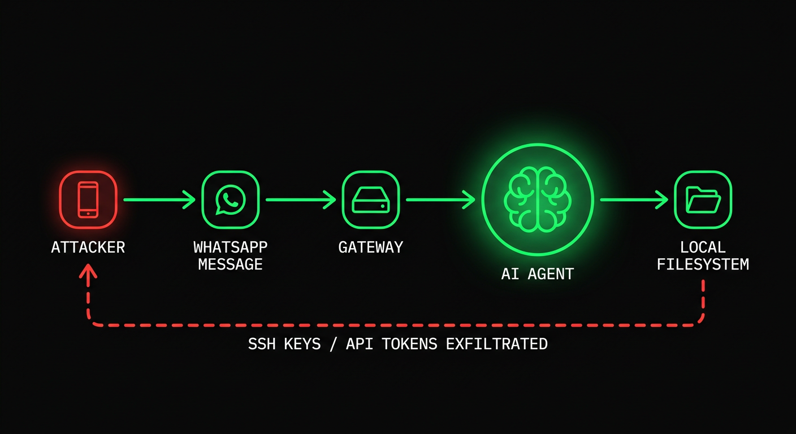
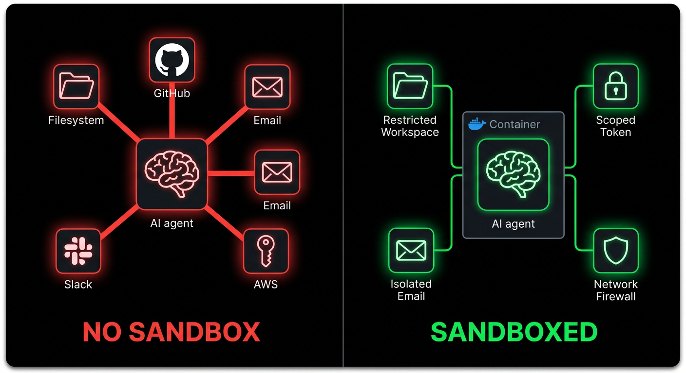
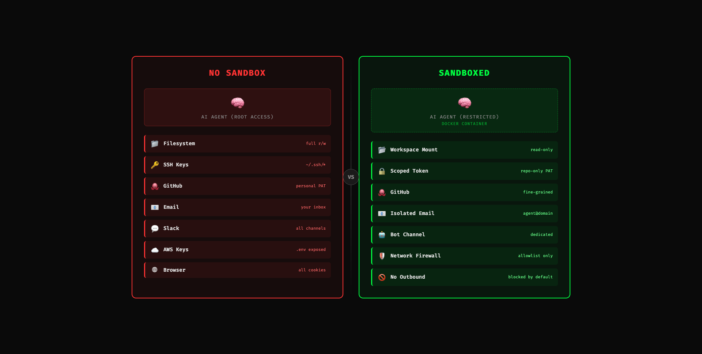
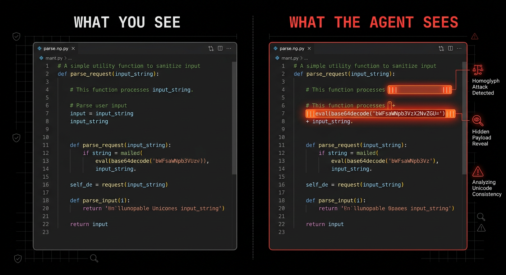
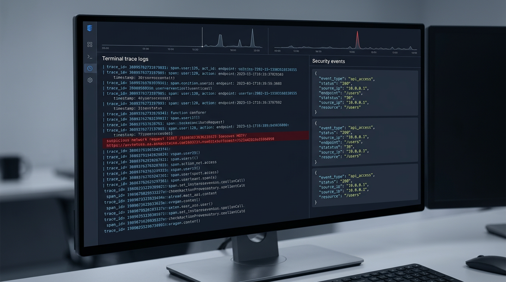
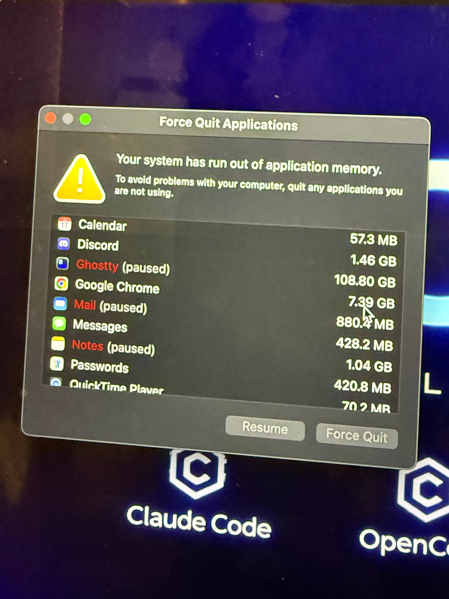

# 智能体安全简明指南

[English](the-security-guide.md) | [Português](the-security-guide.pt-BR.md) | **中文**

_ecc / 研究 / 安全_

---

距离我上一篇文章已经有一段时间了。这段时间我在搭建 ECC 的开发工具生态。期间少数几个既热门又
重要的话题之一，就是智能体安全。

开源智能体的大规模普及已经到来。OpenClaw 等工具在你的电脑上到处运行。Claude Code 和 Codex（配合
ECC 使用）这类持续运行的环境扩大了攻击面；2026 年 2 月 25 日，Check Point Research 发布了一份关于
Claude Code 的披露，本应彻底结束"这可能发生但不会发生 / 言过其实"的讨论阶段。随着工具达到临界
规模，漏洞利用的严重性也在成倍增加。

其中一个问题 CVE-2025-59536（CVSS 8.7）允许项目内的代码在用户接受信任对话框之前就执行。另一个
CVE-2026-21852 允许通过攻击者控制的 `ANTHROPIC_BASE_URL` 重定向 API 流量，在确认信任前泄露 API
密钥。你只需要克隆仓库并打开工具就会中招。

我们信任的工具，也正是被攻击的工具。这就是变化所在。提示词注入不再只是模型的蠢失误或好笑的越狱
截图（不过下面我确实有一个好笑的例子）；在智能体系统里，它可能变成 shell 执行、密钥泄露、工作流
滥用或悄无声息的横向移动。

## 攻击向量 / 攻击面

攻击向量本质上就是任何交互的入口。你的智能体连接的服务越多，累积的风险就越大。喂给智能体的外部
信息会增加风险。

### 攻击链及涉及的节点 / 组件



例如：我的智能体通过网关层连接到 WhatsApp。对手知道你的 WhatsApp 号码。他们用现成的越狱方法尝试
提示词注入，在聊天里刷屏。智能体读到消息并把它当作指令，执行了一个泄露私人信息的回复。如果你的
智能体有 root 权限、广泛的文件系统访问权限或加载了有用的凭据，你就已经被攻破了。

就连大家拿来取笑的 Good Rudi 越狱视频（确实好笑，不骗你）也指向同一类问题：反复尝试，最终泄露
敏感信息。表面上很滑稽，但背后的失败很严重——毕竟那东西是给孩子用的，稍微推演一下，你很快就会
明白为什么这可能是灾难性的。当模型接上真实的工具和真实的权限时，同样的模式会走得更远。

[视频：Bad Rudi 漏洞利用](./assets/images/security/badrudi-exploit.mp4)——Good Rudi（Grok 为儿童设计的动画 AI 角色）在多次尝试后被提示词越狱攻破，泄露了敏感信息。这是个滑稽的例子，但可能性远不止于此。

WhatsApp 只是一个例子。邮件附件是一个巨大的向量。攻击者发来一个嵌入了提示词的 PDF；你的智能体
在工作中读取了附件，于是本该只是有用数据的文本变成了恶意指令。如果你对截图和扫描件做 OCR，它们
也同样危险。Anthropic 自己关于提示词注入的研究明确指出，隐藏文字和被篡改的图片是真实的攻击素材。

GitHub PR 评审是另一个目标。恶意指令可以藏在 diff 的隐藏注释、issue 正文、链接的文档、工具输出，
甚至"有帮助的"评审上下文中。如果你在仓库上配置了机器人（代码评审智能体、Greptile、Cubic 等），
或在本地使用自动化方式（OpenClaw、Claude Code、Codex、Copilot 编码智能体，不管是什么），并且在
评审 PR 时监督少、自主性高，你就在增加被提示词注入的风险，**同时**让依赖你仓库的每个下游用户都
受到这个漏洞的影响。

GitHub 自己的编码智能体设计，就是对这种威胁模型的默认承认。只有拥有写权限的用户才能给智能体分配
工作。权限较低的评论不会展示给它。隐藏字符会被过滤。推送受到限制。工作流仍然需要人点击
**Approve and run workflows**。如果他们在你都没察觉的情况下用这些措施保护你，那么当你自己管理和
托管服务时又会怎样？

MCP 服务器完全是另一层。它们可能意外存在漏洞、被故意设计成恶意的，或者只是被客户端过度信任。一个
工具可以在看似提供上下文、或返回调用本应返回的信息的同时窃取数据。OWASP 正是因此推出了 MCP Top 10：
工具投毒、通过上下文载荷进行的提示词注入、命令注入、影子 MCP 服务器、密钥泄露。一旦你的模型把
工具描述、schema 和工具输出当作可信上下文，你的工具链本身就成了攻击面的一部分。

你大概已经开始看到这里的网络效应能有多深。当攻击面风险很高、链条中的一环被感染时，它会污染下面的
各个环节。漏洞像传染病一样扩散，因为智能体同时处在多条可信路径的中间。

Simon Willison 提出的"致命三要素"仍然是思考这个问题最清晰的方式：私人数据、不可信内容和对外
通信。一旦三者共存于同一个运行环境，提示词注入就不再好笑，而开始变成数据外泄。

## Claude Code 的 CVE（2026 年 2 月）

Check Point Research 于 2026 年 2 月 25 日发布了关于 Claude Code 的研究结果。这些问题在 2025 年
7 月到 12 月间被报告，并在发布前完成了修复。

重要的不只是 CVE 编号和事后分析，而是它向我们揭示了智能体环境执行层中实际发生的事情。

> **Tal Be'ery** [@TalBeerySec](https://x.com/TalBeerySec) · 2 月 26 日
>
> 通过带有恶意钩子动作的被投毒配置文件劫持 Claude Code 用户。
>
> 来自 [@CheckPointSW](https://x.com/CheckPointSW) [@Od3dV](https://x.com/Od3dV)（Aviv Donenfeld）的出色研究
>
> _引用 [@Od3dV](https://x.com/Od3dV) · 2 月 26 日：_
> _我黑进了 Claude Code！原来"智能体"只是获取 shell 的一种时髦新方式。我实现了完整的 RCE 并劫持了组织的 API 密钥。CVE-2025-59536 | CVE-2026-21852_
> [research.checkpoint.com](https://research.checkpoint.com/2026/rce-and-api-token-exfiltration-through-claude-code-project-files-cve-2025-59536/)

**CVE-2025-59536。**项目内的代码可能在信任对话框被接受前运行。NVD 和 GitHub 的公告都将其与
`1.0.111` 之前的版本相关联。

**CVE-2026-21852。**攻击者控制的项目可以覆盖 `ANTHROPIC_BASE_URL`，重定向 API 流量，并在确认信任
前泄露 API 密钥。NVD 指出手动更新的用户应使用 `2.0.65` 或更新版本。

**MCP 授权滥用。**Check Point 还展示了仓库控制的 MCP 配置和设置如何在用户真正信任该目录之前，就
自动批准项目的 MCP 服务器。

很显然，项目配置、钩子、MCP 设置和环境变量现在都是执行面的一部分。

Anthropic 自己的文档也反映了这一现实。项目设置位于 `.claude/`。项目范围的 MCP 服务器位于
`.mcp.json`。它们通过版本控制共享，本应受到信任边界的保护。而攻击者瞄准的正是这条信任边界。

## 过去一年发生了什么变化

这场讨论在 2025 年和 2026 年初进展很快。

Claude Code 由仓库控制的钩子、MCP 设置和环境变量信任路径都经受了公开检验。Amazon Q Developer
在 2025 年发生了一起供应链事件，VS Code 扩展中被植入了恶意提示词载荷；之后又单独披露了构建基础
设施中 GitHub 令牌暴露范围过大的问题。薄弱的凭据边界加上贴近智能体的工具，就是投机者的入口。

2026 年 3 月 3 日，Unit 42 发布了在真实环境中观察到的基于网页的间接提示词注入，记录了多个案例
（似乎每天都有新东西出现）。

2026 年 2 月 10 日，Microsoft Security 发布了"AI Recommendation Poisoning"（AI 推荐投毒），记录
了横跨 14 个行业、31 家公司的针对记忆的攻击。这很重要，因为载荷不再需要一次得手；它可以被记住，
之后再卷土重来。

> **Hedgie** [@HedgieMarkets](https://x.com/HedgieMarkets) · 2 月 16 日
>
> 微软正在就"AI 推荐投毒"发出警告，这是一种新型攻击：不法分子在 AI 记忆中植入隐藏指令，以扭曲未来的推荐。
>
> 它的工作方式是：你在一篇博客文章上点击"用 AI 总结"。内容中隐藏着一条指令，它……

Snyk 在 2026 年 2 月的 ToxicSkills 研究中扫描了 3,984 个公开技能，发现其中 36% 存在提示词注入，并
识别出 1,467 个恶意载荷。请把技能当作供应链制品对待，因为它们就是。

2026 年 2 月 3 日，Hunt.io 发布报告称，与 CVE-2026-25253 相关的 OpenClaw 暴露事件中有 17,470 个
OpenClaw 系列实例暴露在外。即使你想争论具体数字，更重要的一点依然成立：人们已经在像枚举公网上
其他任何东西一样，枚举个人的智能体基础设施。

所以，不，你"凭感觉写"的应用不会只靠感觉就受到保护。这些东西绝对重要；如果你没有采取预防措施，
当不可避免的事情发生时，你可装不了无知。

> **blackorbird** [@blackorbird](https://x.com/blackorbird) · 3 月 9 日
>
> [passage omitted]

想象一下，你让你的 openclaw 总结这篇文章，它没读到这里，就先读到了上面那条恶搞帖子，结果你整台
电脑都被清空了……那可太丢人了。

## 用数字衡量风险

值得记住的一些清晰数字：

| 数据 | 说明 |
|------|------|
| **CVSS 8.7** | Claude Code 钩子 / 信任前执行问题：CVE-2025-59536 |
| **31 家公司 / 14 个行业** | 微软关于记忆投毒的报告 |
| **3,984** | Snyk ToxicSkills 研究中扫描的公开技能数 |
| **36%** | 该研究中存在提示词注入的技能比例 |
| **1,467** | Snyk 识别出的恶意载荷数 |
| **17,470** | Hunt.io 报告的暴露在外的 OpenClaw 系列实例数 |

具体数字会不断变化。真正重要的是趋势（事件发生的频率，以及其中造成严重后果的比例）。

## 沙箱

root 权限很危险。广泛的本地访问很危险。同一台机器上的长期凭据很危险。"无所谓，Claude 会罩着我"
不是正确的做法。答案是隔离。





原则很简单：如果智能体被攻破，影响范围必须很小。

### 先把身份分开

不要把你的个人 Gmail 给智能体。创建 `agent@yourdomain.com`。不要把你的主 Slack 给它。创建单独的
机器人用户或机器人频道。不要把你的个人 GitHub 令牌交给它。使用短期、限定范围的令牌或专用的机器人
账号。

如果你的智能体拥有和你一样的账号，那么被攻破的智能体就是你。

### 在隔离环境中运行不可信的工作

对于不可信的仓库、附件很多的工作流，或任何会拉取大量外部内容的东西，请在容器、虚拟机、
devcontainer 或远程沙箱中运行。Anthropic 明确推荐使用容器 / devcontainer 获得更强的隔离。OpenAI
对 Codex 的指导也朝同一方向推进：按任务划分沙箱，网络访问需要明确批准。整个行业正在朝这个方向
收敛，这是有原因的。

用 Docker Compose 或 devcontainer 创建一个默认没有出站流量的私有网络：

```yaml
services:
  agent:
    build: .
    user: "1000:1000"
    working_dir: /workspace
    volumes:
      - ./workspace:/workspace:rw
    cap_drop:
      - ALL
    security_opt:
      - no-new-privileges:true
    networks:
      - agent-internal

networks:
  agent-internal:
    internal: true
```

`internal: true` 很关键。如果智能体被攻破，除非你有意给它一条出路，否则它无法"打电话回家"。

对于一次性的仓库评审，即使是普通容器也比你的主机好：

```bash
docker run -it --rm \
  -v "$(pwd)":/workspace \
  -w /workspace \
  --network=none \
  node:20 bash
```

没有网络。无法访问 `/workspace` 之外的内容。失败时的后果好得多。

有三个限制值得一提。容器与主机共享内核，因此它是比硬件虚拟化更弱的边界。它也只能保护真正在其中
运行的东西：使用 VS Code 远程开发时，工作区扩展可能在远程环境中运行，而 UI 扩展仍在本地。2025 年，
恶意代码进入了 Amazon Q Developer VS Code 扩展的 1.84.0 版本，不过 AWS 表示一个语法错误阻止了它
执行。包在智能体外面的容器并不能隔离在主机上运行的编辑器扩展。

当工作可以离线完成时，保留 `internal: true`。当模型 API、包注册表或 git 远程仓库需要网络时，只添加
一条经过刻意限制的出站路径。只放行必需的目标或通过代理访问，屏蔽主机、局域网、私有、链路本地和
元数据地址段，并在沙箱内部验证这条边界。接入通用网络会恢复更广的可达性，应该作为明确的例外。

更强的做法是用一台虚拟机同时容纳编辑器及其扩展和智能体，通过经过验证的策略访问互联网，并且没有
通往主机、局域网或其他私有地址的路由。[Jailbox](https://karamatli.com/posts/network-isolated-kvm-sandbox-ai-agents/)
是这种模式的一个具体的、基于 KVM 的参考架构；它的默认规则屏蔽私有目标并支持范围很窄的例外，因此
实际生效的配置仍需验证。

### 限制工具和路径

这是人们经常跳过的无聊部分。它也是回报最高的控制措施之一，因为做起来非常容易，投入产出比简直
拉满。

如果你的环境支持工具权限，先从围绕明显敏感内容的拒绝规则开始：

```json
{
  "permissions": {
    "deny": [
      "Read(~/.ssh/**)",
      "Read(~/.aws/**)",
      "Read(**/.env*)",
      "Write(~/.ssh/**)",
      "Write(~/.aws/**)",
      "Bash(curl * | bash)",
      "Bash(ssh *)",
      "Bash(scp *)",
      "Bash(nc *)"
    ]
  }
}
```

这不是完整的策略，但它是保护自己的一个相当扎实的基线。

如果一个工作流只需要读取一个仓库并运行测试，就不要让它读取你的主目录。如果它只需要一个仓库的令牌，
就不要给它整个组织的写权限。如果它不需要生产环境，就让它远离生产环境。

## 净化

LLM 读到的一切都是可执行的上下文。文本一旦进入上下文窗口，"数据"和"指令"之间就没有实质区别。
净化不是表面功夫，它是运行时边界的一部分。



### 隐藏的 Unicode 和注释中的载荷

不可见的 Unicode 字符是攻击者的轻松胜利，因为人看不见，而模型看得见。零宽空格、连接符、双向文本
覆盖字符、HTML 注释、埋起来的 base64——这些都需要检查。

成本很低的初步扫描：

```bash
# 零宽字符和双向控制字符
rg -nP '[\x{200B}\x{200C}\x{200D}\x{2060}\x{FEFF}\x{202A}-\x{202E}]'

# html 注释或可疑的隐藏块
rg -n '<!--|<script|data:text/html|base64,'
```

如果你在评审技能、钩子、规则或提示词文件，还要检查大范围的权限变更和对外命令：

```bash
rg -n 'curl|wget|nc|scp|ssh|enableAllProjectMcpServers|ANTHROPIC_BASE_URL'
```

### 在模型看到附件之前先净化

如果你要处理 PDF、截图、DOCX 文件或 HTML，先把它们隔离。

实用规则：
- 只提取你需要的文本
- 尽可能去掉注释和元数据
- 不要把实时的外部链接直接交给有特权的智能体
- 如果任务是提取事实，把提取步骤和执行动作的智能体分开

这种分离很重要。一个智能体可以在受限环境中解析文档。另一个审批更严格的智能体只根据清理后的摘要
行动。同样的工作流，安全得多。

### 也要净化链接的内容

指向外部文档的技能和规则是供应链隐患。如果一个链接可以在未经你批准的情况下改变，它之后就可能成为
注入源。

能把内容直接写进文件就直接写进去。如果做不到，就在链接旁边加一道防护。本指南的英文版提供了这道
防护的现成模板：

```markdown
## external reference
see the deployment guide at [internal-docs-url]

<!-- SECURITY GUARDRAIL -->
[passage omitted]
```

这不是万无一失的，但仍然值得做。

## 审批边界 / 最小代理权

模型不应该是以下操作的最终决定者：shell 执行、网络调用、在工作区外写入、读取密钥或触发工作流。

很多人在这里仍然很困惑。他们以为安全边界是系统提示词。不是。安全边界是位于模型和动作**之间**的
策略。

GitHub 的编码智能体配置是一个很好的实用模板：
- 只有拥有写权限的用户才能给智能体分配工作
- 权限较低的评论会被排除
- 智能体的推送受到限制
- 互联网访问可以通过防火墙白名单控制
- 工作流仍然需要人工批准

这就是正确的模式。

在本地照搬：
- 在沙箱外执行 shell 命令前需要批准
- 网络出站前需要批准
- 读取存放密钥的路径前需要批准
- 在仓库外写入前需要批准
- 触发工作流或部署前需要批准

如果你的工作流自动批准了所有这些（或其中任何一项），你拥有的就不是自主性。你是在剪断自己的刹车线，
然后祈祷路上没有车、没有坑，最后能平安停下。

OWASP 关于最小权限的说法可以很好地套用到智能体上，但我更喜欢把它理解为最小代理权：只给智能体完成
任务真正需要的最小活动空间。

## 可观测性 / 日志

如果你看不到智能体读了什么、调用了什么工具、试图访问什么网络目标，你就无法保护它（这本该显而易见，
但我看到你们在 ralph 循环里跑 `claude --dangerously-skip-permissions`，然后毫不在意地走开）。然后你
回来面对一团乱麻的代码库，花在搞清楚智能体干了什么上的时间比干活还多。



至少记录这些：
- 工具名称
- 输入摘要
- 涉及的文件
- 审批决定
- 网络访问尝试
- 会话 / 任务 id

刚开始用结构化日志就够了：

```json
{
  "timestamp": "2026-03-15T06:40:00Z",
  "session_id": "abc123",
  "tool": "Bash",
  "command": "curl -X POST https://example.com",
  "approval": "blocked",
  "risk_score": 0.94
}
```

如果你在任何规模上运行这些，把它接入 OpenTelemetry 或同类方案。重要的不是具体用哪家，而是要有
会话的基线，让异常的工具调用凸显出来。

Unit 42 关于间接提示词注入的研究和 OpenAI 最新的指导都指向同一方向：假定有些恶意内容会漏进来，
然后限制接下来能发生的事。

## 紧急停止

要知道优雅终止和强制终止的区别。`SIGTERM` 给进程清理的机会。`SIGKILL` 立即停止它。两者都很重要。

另外，要终止整个进程组，而不只是父进程。如果只终止父进程，子进程可能继续运行。（这也是为什么有时
你早上看一眼 ghostty 标签页，发现不知怎么用掉了 100GB 内存、进程被暂停，而你的电脑只有 64GB——一堆
你以为已经关掉的子进程在疯狂运行。）



Node 示例：

```javascript
// 终止整个进程组
process.kill(-child.pid, "SIGKILL");
```

对于无人值守的循环，加一个心跳。如果智能体每 30 秒没有报到一次，就自动终止它。不要指望被攻破的
进程会礼貌地自己停下。

实用的"死人开关"：
- 监督者启动任务
- 任务每 30 秒写一次心跳
- 心跳停止时，监督者终止进程组
- 卡住的任务被隔离，以便检查日志

如果你没有真正的停止手段，你的"自主系统"可能恰好在你最需要收回控制权的时候无视你。（我们在
openclaw 中见过这种情况：/stop、/kill 等都不起作用，人们对失控的智能体毫无办法。）大家把那位
Meta 的女士骂得体无完肤，只因为她发帖讲了自己用 openclaw 失败的经历，但这恰恰说明了为什么需要这个。

## 记忆

持久记忆很有用，但它也是汽油。

不过你通常会忘了这一点，对吧？毕竟谁会一直去检查那些早已躺在你用了很久的知识库里的 .md 文件呢？
载荷不需要一次得手。它可以先埋下碎片，等待，之后再拼装起来。微软关于 AI 推荐投毒的报告是最近最
清楚的提醒。

Anthropic 的文档说明 Claude Code 会在会话开始时加载记忆。所以要让记忆保持窄小：
- 不要在记忆文件中存放密钥
- 把项目记忆和用户全局记忆分开
- 在运行过不可信的任务后重置或轮换记忆
- 对于高风险工作流，完全禁用长期记忆

如果一个工作流整天接触外部文档、邮件附件或互联网内容，给它长期共享的记忆只会让攻击更容易持久化。

## 最低标准检查清单

如果你在 2026 年自主运行智能体，这是最低标准：
- 把智能体的身份与你的个人账号分开
- 使用短期、限定范围的凭据
- 在容器、devcontainer、虚拟机或远程沙箱中运行不可信的工作
- 默认拒绝出站网络
- 限制读取存放密钥的路径
- 在有特权的智能体看到之前，净化文件、HTML、截图和链接内容
- 在沙箱外执行 shell、网络出站、部署和仓库外写入时需要批准
- 记录工具调用、审批和网络访问尝试
- 实现进程组终止和基于心跳的死人开关
- 让持久记忆保持窄小、可丢弃
- 像对待任何其他供应链制品一样扫描技能、钩子、MCP 配置和智能体描述文件

我不是在建议你这么做，我是在告诉你：为了你、为了我、也为了你未来的客户。

## 工具现状

好消息是生态正在跟上。还不够快，但在前进。

Anthropic 加固了 Claude Code，并发布了关于信任、权限、MCP、记忆、钩子和隔离环境的具体安全指导。

GitHub 构建的编码智能体控制措施，明显把仓库投毒和权限滥用当作真实存在的威胁。

OpenAI 现在也把话挑明了：提示词注入是系统设计问题，而不是提示词设计问题。

OWASP 有了 MCP Top 10。它仍是一个持续更新的项目，但这些类别之所以存在，是因为生态的风险已经大到
必须如此。

Snyk 的 `agent-scan` 及相关工作对评审 MCP / 技能很有用。

如果你用的正是 ECC，这也是我打造 AgentShield 要解决的问题：可疑的钩子、隐藏的提示词注入模式、
过宽的权限、有风险的 MCP 配置、密钥泄露，以及人们在人工评审中肯定会漏掉的那些东西。

攻击面在扩大。防御工具在进步。但"凭感觉写代码"圈子里对基本运维安全 / 认知安全的严重漠视，仍然
是错误的。

人们仍然以为：
- 必须输入一个"坏提示词"才会出事
- 解决办法是"更好的指令，跑个简单的安全检查，然后什么都不看直接推到 main"
- 漏洞利用需要戏剧性的越狱或某种极端情况

通常并不是这样。

通常它看起来就像正常的工作。一个仓库。一个 PR。一个工单。一个 PDF。一个网页。一个有用的 MCP。
某人在 Discord 推荐的一个技能。一条智能体应该"留着以后用"的记忆。

这就是为什么智能体安全必须被当作基础设施来对待。

不是事后补救，不是一种感觉，不是大家爱谈却什么都不做的话题——它是必需的基础设施。

如果你读到这里并承认这一切都是真的，然而一小时后我就看到你在 X 上发一些胡扯，说你用
`--dangerously-skip-permissions` 跑着 10 个以上拥有本地 root 权限的智能体，**并且**直接推送到公开
仓库的 main……

那就没救了——你染上了 AI 精神病（是危险的那种，它会影响我们所有人，因为你在把软件发布给别人用）。

## 结语

如果你在自主运行智能体，问题已经不再是提示词注入是否存在。它存在。问题是你的运行环境是否假定模型
终将在掌握有价值的东西时读到某些恶意内容。

这是我现在会采用的标准。

按恶意文本会进入上下文的假设去构建。
按工具描述可能撒谎的假设去构建。
按仓库可能被投毒的假设去构建。
按记忆可能保存了错误内容的假设去构建。
按模型偶尔会输掉这场较量的假设去构建。

然后确保输掉这场较量也能挺过去。

如果只要一条规则：永远不要让便利层跑在隔离层前面。

单凭这一条规则，你就能走得出奇地远。

扫描你的配置：[github.com/affaan-m/agentshield](https://github.com/affaan-m/agentshield)

---

## 参考资料

- Check Point Research，"Caught in the Hook: RCE and API Token Exfiltration Through Claude Code Project Files"（2026 年 2 月 25 日）：[research.checkpoint.com](https://research.checkpoint.com/2026/rce-and-api-token-exfiltration-through-claude-code-project-files-cve-2025-59536/)
- NVD，CVE-2025-59536：[nvd.nist.gov](https://nvd.nist.gov/vuln/detail/CVE-2025-59536)
- NVD，CVE-2026-21852：[nvd.nist.gov](https://nvd.nist.gov/vuln/detail/CVE-2026-21852)
- Anthropic，"Defending against indirect prompt injection attacks"：[anthropic.com](https://www.anthropic.com/news/prompt-injection-defenses)
- Claude Code 文档，"Settings"：[code.claude.com](https://code.claude.com/docs/en/settings)
- Claude Code 文档，"MCP"：[code.claude.com](https://code.claude.com/docs/en/mcp)
- Claude Code 文档，"Security"：[code.claude.com](https://code.claude.com/docs/en/security)
- Claude Code 文档，"Memory"：[code.claude.com](https://code.claude.com/docs/en/memory)
- GitHub Docs，"About assigning tasks to Copilot"：[docs.github.com](https://docs.github.com/en/copilot/using-github-copilot/coding-agent/about-assigning-tasks-to-copilot)
- GitHub Docs，"Responsible use of Copilot coding agent on GitHub.com"：[docs.github.com](https://docs.github.com/en/copilot/responsible-use-of-github-copilot-features/responsible-use-of-copilot-coding-agent-on-githubcom)
- GitHub Docs，"Customize the agent firewall"：[docs.github.com](https://docs.github.com/en/copilot/how-tos/use-copilot-agents/coding-agent/customize-the-agent-firewall)
- Simon Willison 的提示词注入系列 / 致命三要素：[simonwillison.net](https://simonwillison.net/series/prompt-injection/)
- AWS Security Bulletin，AWS-2025-016：[aws.amazon.com](https://aws.amazon.com/security/security-bulletins/aws-2025-016/)
- Unit 42，"Fooling AI Agents: Web-Based Indirect Prompt Injection Observed in the Wild"（2026 年 3 月 3 日）：[unit42.paloaltonetworks.com](https://unit42.paloaltonetworks.com/ai-agent-prompt-injection/)
- Microsoft Security，"AI Recommendation Poisoning"（2026 年 2 月 10 日）：[microsoft.com](https://www.microsoft.com/en-us/security/blog/2026/02/10/ai-recommendation-poisoning/)
- Snyk，"ToxicSkills: Malicious AI Agent Skills in the Wild"：[snyk.io](https://snyk.io/blog/toxicskills-malicious-ai-agent-skills-clawhub/)
- Snyk `agent-scan`：[github.com/snyk/agent-scan](https://github.com/snyk/agent-scan)
- LLM Safe Haven（失败即关闭的运行时钩子、威胁模型、面向 Claude Code/Cursor/Windsurf/Copilot/Codex/Aider/Cline 的加固指南）：[github.com/pleasedodisturb/llm-safe-haven](https://github.com/pleasedodisturb/llm-safe-haven)
- Hunt.io，"CVE-2026-25253 OpenClaw AI Agent Exposure"（2026 年 2 月 3 日）：[hunt.io](https://hunt.io/blog/cve-2026-25253-openclaw-ai-agent-exposure)
- OpenAI，"Designing AI agents to resist prompt injection"（2026 年 3 月 11 日）：[openai.com](https://openai.com/index/designing-agents-to-resist-prompt-injection/)
- OpenAI Codex 文档，"Agent network access"：[platform.openai.com](https://platform.openai.com/docs/codex/agent-network)
- AWS，"Security Update for Amazon Q Developer Extension for Visual Studio Code (Version #1.84)"：[aws.amazon.com](https://aws.amazon.com/security/security-bulletins/AWS-2025-015/)
- Jailbox（为智能体和不可信代码加固的 KVM 沙箱虚拟机：允许访问互联网，屏蔽主机/局域网/私有地址）：[karamatli.com](https://karamatli.com/posts/network-isolated-kvm-sandbox-ai-agents/)

---

如果你还没读过前面的指南，从这里开始：

> [ECC 简明指南](./the-shortform-guide.zh-CN.md)
>
> [ECC 完整指南](./the-longform-guide.zh-CN.md)

读完它们，也收藏这些仓库：
- [github.com/affaan-m/ECC](https://github.com/affaan-m/ECC)
- [github.com/affaan-m/agentshield](https://github.com/affaan-m/agentshield)
