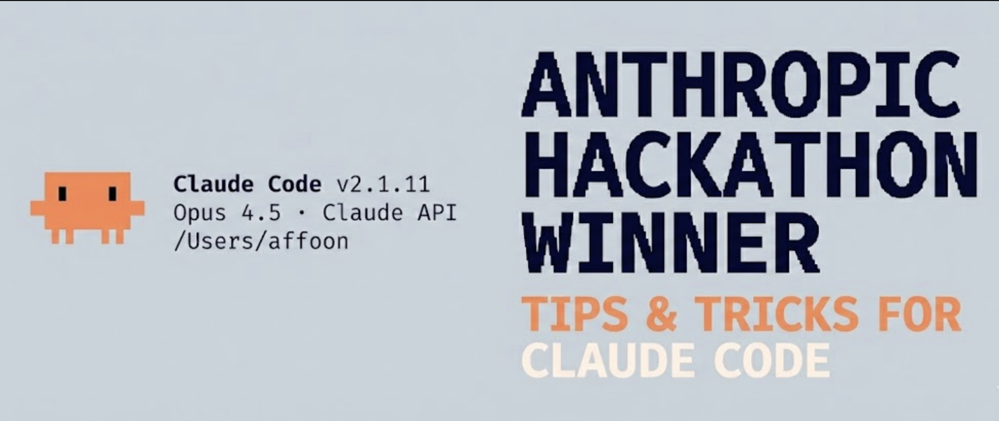
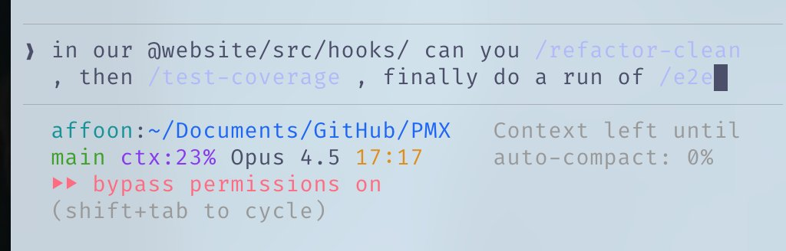
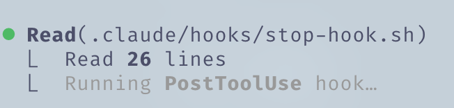
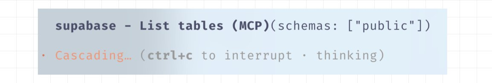
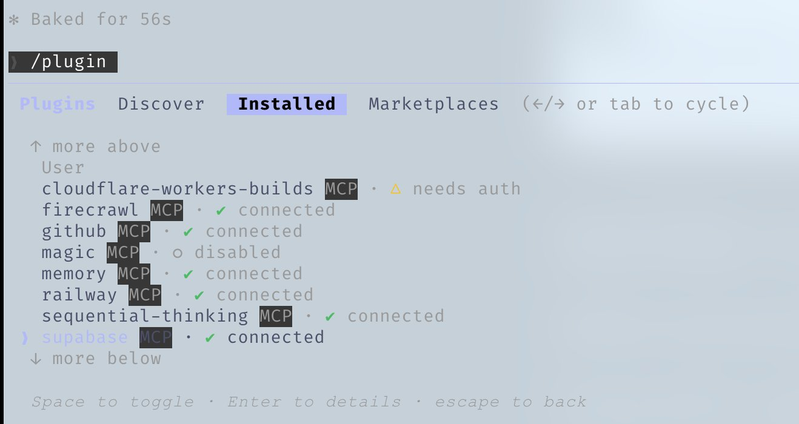
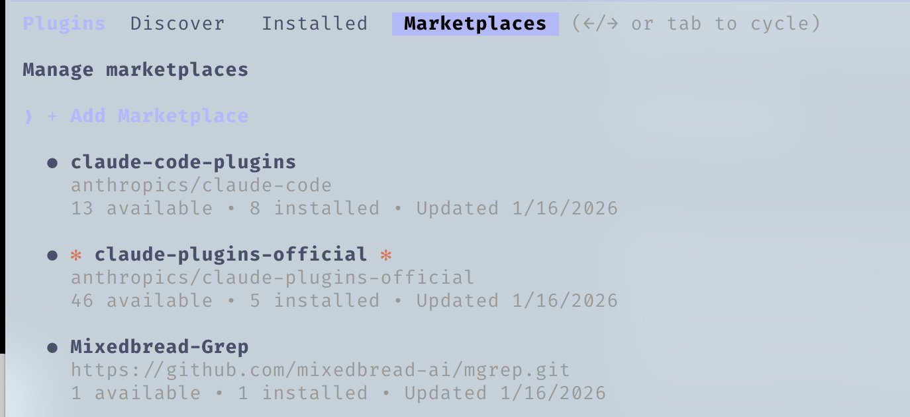
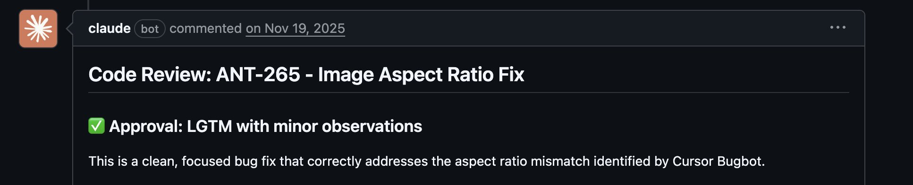
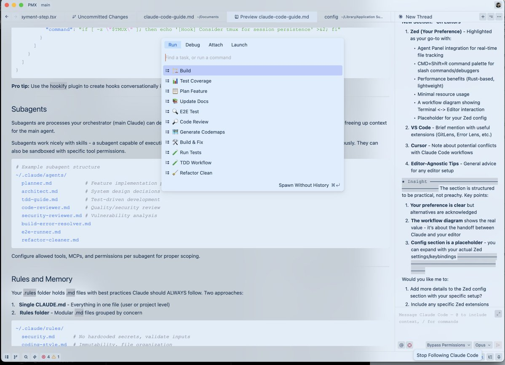
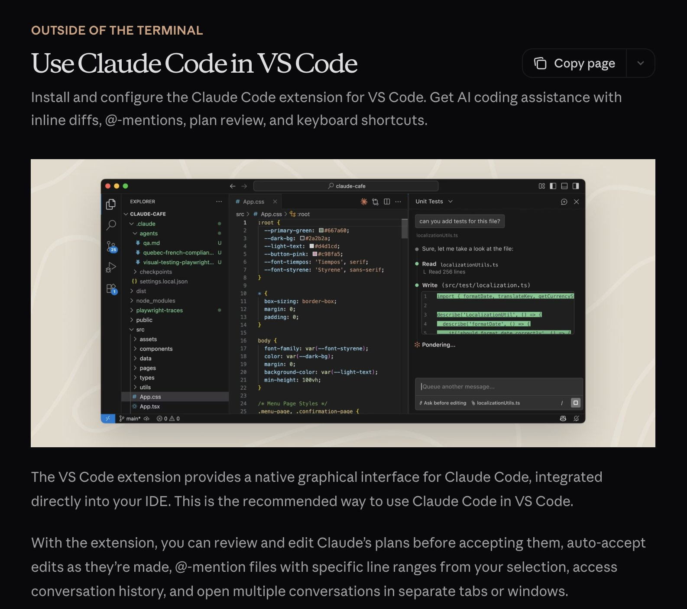
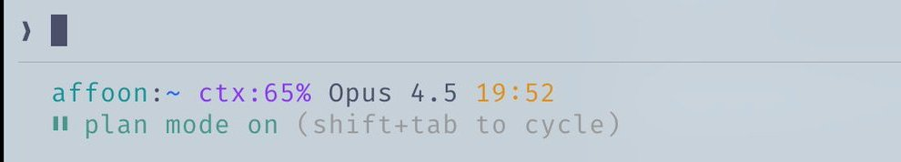

# O guia resumido do ECC

[English](the-shortform-guide.md) | **Português** | [中文](the-shortform-guide.zh-CN.md)



---

**Uso o Claude Code intensamente desde o lançamento experimental em fevereiro e venci o hackathon Anthropic x Forum Ventures com o [zenith.chat](https://zenith.chat), junto com [@DRodriguezFX](https://x.com/DRodriguezFX), usando só o Claude Code.**

Esta é a minha configuração completa depois de 10 meses de uso diário: skills,
hooks, subagentes, MCPs, plugins e o que de fato funciona.

---

## Skills e comandos

As skills são a principal forma de definir fluxos de trabalho. Elas funcionam
como pacotes de fluxo com escopo definido: prompts reutilizáveis, estrutura,
arquivos de apoio e mapas de código para quando você precisa de um padrão de
execução específico.

Depois de uma longa sessão programando com o Opus 4.5, quer limpar código morto
e arquivos .md soltos? Rode `/refactor-clean`. Precisa de testes? `/tdd`,
`/e2e`, `/test-coverage`. Esses atalhos de barra são práticos, mas a unidade que
dura de verdade é a skill por trás deles. Skills também podem incluir mapas de
código, um jeito de o Claude navegar rápido pelo seu projeto sem gastar contexto
explorando.


*Encadeando comandos*

O ECC ainda traz uma camada `commands/`, mas o melhor é vê-la como
compatibilidade com os atalhos de barra antigos durante a migração. A lógica
duradoura deve morar nas skills.

- **Skills**: `~/.claude/skills/`, as definições canônicas dos fluxos
- **Comandos**: `~/.claude/commands/`, shims dos atalhos de barra antigos, para
  quando você ainda precisar deles

```bash
# Exemplo de estrutura de skills
~/.claude/skills/
  pmx-guidelines.md      # Padrões específicos do projeto
  coding-standards.md    # Boas práticas da linguagem
  tdd-workflow/          # Skill com vários arquivos e um SKILL.md
  security-review/       # Skill baseada em checklist
```

---

## Hooks

Hooks são automações disparadas por eventos específicos. Diferente das skills,
eles se limitam a chamadas de ferramentas e eventos do ciclo de vida.

**Tipos de hook:**

1. **PreToolUse**: antes de uma ferramenta rodar (validação, lembretes)
2. **PostToolUse**: depois de uma ferramenta terminar (formatação, ciclos de feedback)
3. **UserPromptSubmit**: quando você envia uma mensagem
4. **Stop**: quando o Claude termina de responder
5. **PreCompact**: antes da compactação do contexto
6. **Notification**: pedidos de permissão

**Exemplo: lembrete de tmux antes de comandos demorados**

```json
{
  "PreToolUse": [
    {
      "matcher": "tool == \"Bash\" && tool_input.command matches \"(npm|pnpm|yarn|cargo|pytest)\"",
      "hooks": [
        {
          "type": "command",
          "command": "if [ -z \"$TMUX\" ]; then echo '[Hook] Consider tmux for session persistence' >&2; fi"
        }
      ]
    }
  ]
}
```


*Exemplo do feedback que aparece no Claude Code enquanto um hook PostToolUse roda*

**Dica:** use o plugin `hookify` para criar hooks conversando, em vez de
escrever JSON à mão. Rode `/hookify` e descreva o que você quer.

---

## Subagentes

Subagentes são processos para os quais o orquestrador (o Claude principal) pode
delegar tarefas com escopo limitado. Eles podem rodar em segundo ou primeiro
plano, liberando contexto para o agente principal.

Subagentes combinam bem com skills: um subagente capaz de executar um
subconjunto das suas skills pode receber tarefas e usar essas skills sozinho.
Eles também podem ficar isolados, com permissões de ferramentas específicas.

```bash
# Exemplo de estrutura de subagentes
~/.claude/agents/
  planner.md           # Planejamento da implementação de funcionalidades
  architect.md         # Decisões de design do sistema
  tdd-guide.md         # Desenvolvimento guiado por testes
  code-reviewer.md     # Revisão de qualidade/segurança
  security-reviewer.md # Análise de vulnerabilidades
  build-error-resolver.md
  e2e-runner.md
  refactor-cleaner.md
```

Configure as ferramentas, MCPs e permissões permitidos para cada subagente, para
manter o escopo certo.

---

## Regras e memória

A sua pasta `.rules` guarda arquivos `.md` com boas práticas que o Claude deve
SEMPRE seguir. Há duas abordagens:

1. **Um único CLAUDE.md**: tudo num arquivo (no nível do usuário ou do projeto)
2. **Pasta de regras**: arquivos `.md` modulares, agrupados por assunto

```bash
~/.claude/rules/
  security.md      # Nada de segredos fixos no código, validar entradas
  coding-style.md  # Imutabilidade, organização de arquivos
  testing.md       # Fluxo de TDD, 80% de cobertura
  git-workflow.md  # Formato de commit, processo de PR
  agents.md        # Quando delegar para subagentes
  performance.md   # Escolha de modelo, gestão de contexto
```

**Exemplos de regras:**

- Nada de emojis no código
- Evitar tons de roxo no frontend
- Sempre testar o código antes do deploy
- Preferir código modular a arquivos gigantes
- Nunca fazer commit de console.log

---

## MCPs (Model Context Protocol)

MCPs conectam o Claude direto a serviços externos. Eles não substituem APIs: são
um invólucro guiado por prompts em volta delas, que dá mais flexibilidade para
navegar pela informação.

**Exemplo:** o MCP do Supabase deixa o Claude buscar dados específicos e rodar
SQL direto na origem, sem copiar e colar. O mesmo vale para bancos de dados,
plataformas de deploy etc.


*Exemplo do MCP do Supabase listando as tabelas do schema public*

**Chrome no Claude:** é um MCP de plugin embutido que deixa o Claude controlar o
seu navegador sozinho, clicando para ver como as coisas funcionam.

**CRÍTICO: gestão da janela de contexto**

Seja seletivo com MCPs. Eu deixo todos os MCPs na configuração do usuário, mas
**desativo tudo o que não uso**. Vá em `/plugins` e role a tela, ou rode `/mcp`.


*Usando /plugins para chegar aos MCPs e ver quais estão instalados e o status de cada um*

A sua janela de 200k antes de compactar pode virar só 70k com ferramentas demais
ativadas. O desempenho cai bastante.

**Regra prática:** tenha de 20 a 30 MCPs configurados, mas mantenha menos de 10
ativados e menos de 80 ferramentas ativas.

```bash
# Ver os MCPs ativados
/mcp

# Desative os que não usa em ~/.claude/settings.json ou no .mcp.json do repositório atual
```

---

## Plugins

Plugins empacotam ferramentas para instalar com facilidade, sem a configuração
manual chata. Um plugin pode ser uma skill com um MCP, ou hooks e ferramentas
juntos.

**Instalando plugins:**

```bash
# Adicione um marketplace
# Plugin mgrep, de @mixedbread-ai
claude plugin marketplace add https://github.com/mixedbread-ai/mgrep

# Abra o Claude, rode /plugins, encontre o marketplace novo e instale por lá
```


*O marketplace Mixedbread-Grep recém-instalado*

**Plugins de LSP** são especialmente úteis se você costuma rodar o Claude Code
fora de editores. O Language Server Protocol dá ao Claude checagem de tipos em
tempo real, ir para a definição e autocompletar inteligente sem precisar de uma
IDE aberta.

```bash
# Exemplo de plugins ativados
typescript-lsp@claude-plugins-official  # Inteligência de TypeScript
pyright-lsp@claude-plugins-official     # Checagem de tipos em Python
hookify@claude-plugins-official         # Criar hooks conversando
mgrep@Mixedbread-Grep                   # Busca melhor que o ripgrep
```

O mesmo alerta dos MCPs vale aqui: cuide da sua janela de contexto.

---

## Dicas e truques

### Atalhos de teclado

- `Ctrl+U`: apaga a linha inteira (mais rápido que apertar backspace várias vezes)
- `!`: prefixo para um comando bash rápido
- `@`: busca arquivos
- `/`: inicia comandos de barra
- `Shift+Enter`: entrada com várias linhas
- `Tab`: mostra/esconde o raciocínio
- `Esc Esc`: interrompe o Claude / restaura o código

### Fluxos em paralelo

- **Fork** (`/fork`): bifurca conversas para fazer tarefas que não se sobrepõem
  em paralelo, em vez de encher a fila de mensagens
- **Git worktrees**: para vários Claudes em paralelo em tarefas que se
  sobrepõem, sem conflitos. Cada worktree é um checkout independente

```bash
git worktree add ../feature-branch feature-branch
# Agora rode uma instância separada do Claude em cada worktree
```

### tmux para comandos demorados

Acompanhe ao vivo os logs e processos bash que o Claude roda:

[Veja: sessão do tmux acompanhando um comando demorado (vídeo)](./assets/images/shortform/07-tmux-video.mp4)

```bash
tmux new -s dev
# O Claude roda os comandos aqui; você pode sair e voltar
tmux attach -t dev
```

### mgrep > grep

O `mgrep` é uma melhoria grande em relação ao ripgrep/grep. Instale pelo
marketplace de plugins e use a skill `/mgrep`. Funciona para busca local e na
web.

```bash
mgrep "function handleSubmit"  # Busca local
mgrep --web "Next.js 15 app router changes"  # Busca na web
```

### Outros comandos úteis

- `/rewind`: volta a um estado anterior
- `/statusline`: personaliza a barra de status com branch, % de contexto, tarefas
- `/checkpoints`: pontos de desfazer por arquivo
- `/compact`: dispara a compactação do contexto manualmente

### CI/CD com GitHub Actions

Configure revisão de código nos seus PRs com GitHub Actions. Depois de
configurado, o Claude pode revisar PRs automaticamente.


*O Claude aprovando um PR de correção de bug*

### Sandbox

Use o modo sandbox para operações arriscadas: o Claude roda num ambiente
restrito, sem afetar o seu sistema de verdade.

---

## Sobre editores

A escolha do editor afeta muito o fluxo com o Claude Code. O Claude Code
funciona em qualquer terminal, mas usá-lo com um bom editor libera
acompanhamento de arquivos em tempo real, navegação rápida e execução integrada
de comandos.

### Zed (o meu preferido)

Eu uso o [Zed](https://zed.dev). Ele é escrito em Rust, então é rápido de
verdade. Abre na hora, aguenta projetos enormes sem esforço e quase não usa
recursos do sistema.

**Por que Zed + Claude Code é uma ótima combinação:**

- **Velocidade**: o desempenho do Rust evita travadas quando o Claude edita
  arquivos em sequência. O editor acompanha
- **Integração com o painel de agentes**: a integração do Zed com o Claude
  permite acompanhar em tempo real as mudanças nos arquivos enquanto o Claude
  edita. Você pula entre os arquivos que o Claude cita sem sair do editor
- **Paleta de comandos CMD+Shift+R**: acesso rápido a todos os seus comandos de
  barra, depuradores e scripts de build numa interface com busca
- **Uso mínimo de recursos**: não disputa RAM/CPU com o Claude em operações
  pesadas. Importante quando você roda o Opus
- **Modo Vim**: atalhos completos do vim, se for a sua praia


*Editor Zed com o menu de comandos personalizados aberto via CMD+Shift+R. O modo de acompanhamento aparece como o alvo no canto inferior direito.*

**Dicas que valem para qualquer editor:**

1. **Divida a tela**: o terminal com o Claude Code de um lado, o editor do outro
2. **Ctrl + G**: abre rápido no Zed o arquivo em que o Claude está trabalhando
3. **Salvamento automático**: ative-o para que o Claude sempre leia a versão
   atual dos arquivos
4. **Integração com git**: use os recursos de git do editor para revisar as
   mudanças do Claude antes do commit
5. **Monitoramento de arquivos**: a maioria dos editores recarrega sozinha os
   arquivos alterados; confirme que isso está ativado

### VSCode / Cursor

Também é uma boa escolha e funciona bem com o Claude Code. Você pode usar no
formato de terminal, com sincronização automática com o editor via `\ide`, que
ativa os recursos de LSP (hoje meio redundante com os plugins). Ou pode optar
pela extensão, que é mais integrada ao editor e tem uma interface combinando.


*A extensão para VS Code oferece uma interface gráfica nativa para o Claude Code, integrada direto na IDE.*

---

## A minha configuração

### Plugins

**Instalados:** (normalmente deixo só 4 ou 5 deles ativados ao mesmo tempo)

```markdown
ralph-wiggum@claude-code-plugins       # Automação de ciclos
frontend-patterns@claude-code-plugins  # Padrões de UI/UX
commit-commands@claude-code-plugins    # Fluxo de git
security-guidance@claude-code-plugins  # Verificações de segurança
pr-review-toolkit@claude-code-plugins  # Automação de PRs
typescript-lsp@claude-plugins-official # Inteligência de TS
hookify@claude-plugins-official        # Criação de hooks
code-simplifier@claude-plugins-official
feature-dev@claude-code-plugins
explanatory-output-style@claude-code-plugins
code-review@claude-code-plugins
context7@claude-plugins-official       # Documentação atual
pyright-lsp@claude-plugins-official    # Tipos em Python
mgrep@Mixedbread-Grep                  # Busca melhor
```

### Servidores MCP

**Configurados (no nível do usuário):**

```json
{
  "github": { "command": "npx", "args": ["-y", "@modelcontextprotocol/server-github"] },
  "firecrawl": { "command": "npx", "args": ["-y", "firecrawl-mcp"] },
  "supabase": {
    "command": "npx",
    "args": ["-y", "@supabase/mcp-server-supabase@latest", "--project-ref=YOUR_REF"]
  },
  "memory": { "command": "npx", "args": ["-y", "@modelcontextprotocol/server-memory"] },
  "sequential-thinking": {
    "command": "npx",
    "args": ["-y", "@modelcontextprotocol/server-sequential-thinking"]
  },
  "vercel": { "type": "http", "url": "https://mcp.vercel.com" },
  "railway": { "command": "npx", "args": ["-y", "@railway/mcp-server"] },
  "cloudflare-docs": { "type": "http", "url": "https://docs.mcp.cloudflare.com/mcp" },
  "cloudflare-workers-bindings": {
    "type": "http",
    "url": "https://bindings.mcp.cloudflare.com/mcp"
  },
  "clickhouse": { "type": "http", "url": "https://mcp.clickhouse.cloud/mcp" },
  "AbletonMCP": { "command": "uvx", "args": ["ableton-mcp"] },
  "magic": { "command": "npx", "args": ["-y", "@magicuidesign/mcp@latest"] }
}
```

Este é o segredo: tenho 14 MCPs configurados, mas só uns 5 ou 6 ativados por
projeto. Isso mantém a janela de contexto saudável.

### Hooks principais

```json
{
  "PreToolUse": [
    { "matcher": "npm|pnpm|yarn|cargo|pytest", "hooks": ["tmux reminder"] },
    { "matcher": "Write && .md file", "hooks": ["block unless README/CLAUDE"] },
    { "matcher": "git push", "hooks": ["open editor for review"] }
  ],
  "PostToolUse": [
    { "matcher": "Edit && .ts/.tsx/.js/.jsx", "hooks": ["prettier --write"] },
    { "matcher": "Edit && .ts/.tsx", "hooks": ["tsc --noEmit"] },
    { "matcher": "Edit", "hooks": ["grep console.log warning"] }
  ],
  "Stop": [
    { "matcher": "*", "hooks": ["check modified files for console.log"] }
  ]
}
```

### Barra de status personalizada

Mostra usuário, pasta, branch do git com indicador de mudanças, % de contexto
restante, modelo, hora e número de tarefas:


*Exemplo da barra de status na pasta raiz do meu Mac*

```
affoon:~ ctx:65% Opus 4.5 19:52
▌▌ plan mode on (shift+tab to cycle)
```

### Estrutura de regras

```
~/.claude/rules/
  security.md      # Verificações de segurança obrigatórias
  coding-style.md  # Imutabilidade, limites de tamanho de arquivo
  testing.md       # TDD, 80% de cobertura
  git-workflow.md  # Conventional commits
  agents.md        # Regras de delegação para subagentes
  patterns.md      # Formatos de resposta de API
  performance.md   # Escolha de modelo (Haiku x Sonnet x Opus)
  hooks.md         # Documentação dos hooks
```

### Subagentes

```
~/.claude/agents/
  planner.md           # Divide funcionalidades em partes
  architect.md         # Design do sistema
  tdd-guide.md         # Escreve os testes primeiro
  code-reviewer.md     # Revisão de qualidade
  security-reviewer.md # Varredura de vulnerabilidades
  build-error-resolver.md
  e2e-runner.md        # Testes com Playwright
  refactor-cleaner.md  # Remoção de código morto
  doc-updater.md       # Mantém a documentação em dia
```

---

## Principais lições

1. **Não complique demais**: trate a configuração como ajuste fino, não como
   arquitetura
2. **A janela de contexto é preciosa**: desative MCPs e plugins que não usa
3. **Execução em paralelo**: bifurque conversas, use git worktrees
4. **Automatize o repetitivo**: hooks para formatação, lint e lembretes
5. **Limite o escopo dos subagentes**: menos ferramentas = execução mais focada

---

## Referências

- [Plugins Reference](https://code.claude.com/docs/en/plugins-reference)
- [Hooks Documentation](https://code.claude.com/docs/en/hooks)
- [Checkpointing](https://code.claude.com/docs/en/checkpointing)
- [Interactive Mode](https://code.claude.com/docs/en/interactive-mode)
- [Memory System](https://code.claude.com/docs/en/memory)
- [Subagents](https://code.claude.com/docs/en/sub-agents)
- [MCP Overview](https://code.claude.com/docs/en/mcp)

---

**Observação:** isto é só uma parte dos detalhes. Veja o [guia completo](./the-longform-guide.pt-BR.md) para padrões avançados.

---

*Venceu o hackathon Anthropic x Forum Ventures em Nova York criando o [zenith.chat](https://zenith.chat) com [@DRodriguezFX](https://x.com/DRodriguezFX)*
