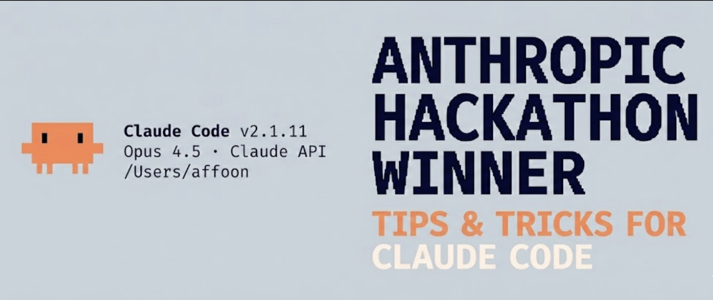
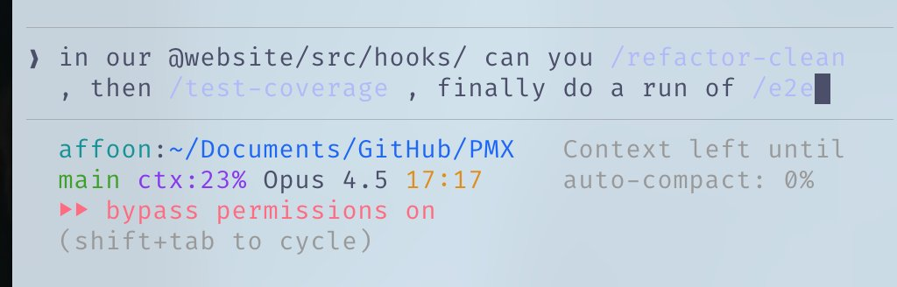
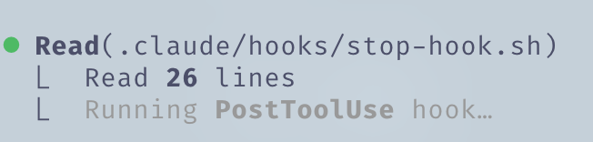
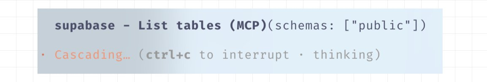
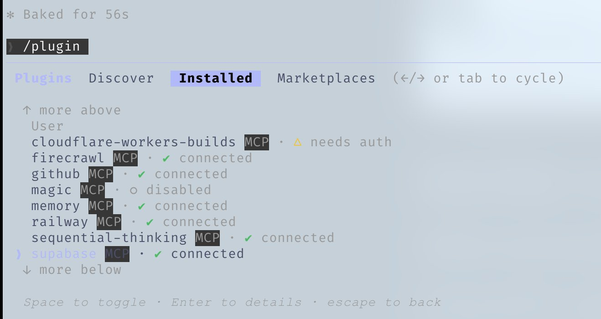
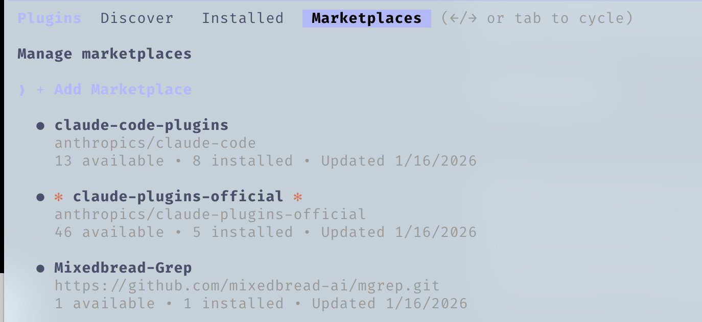
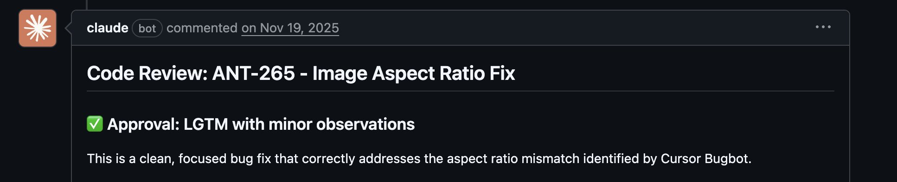
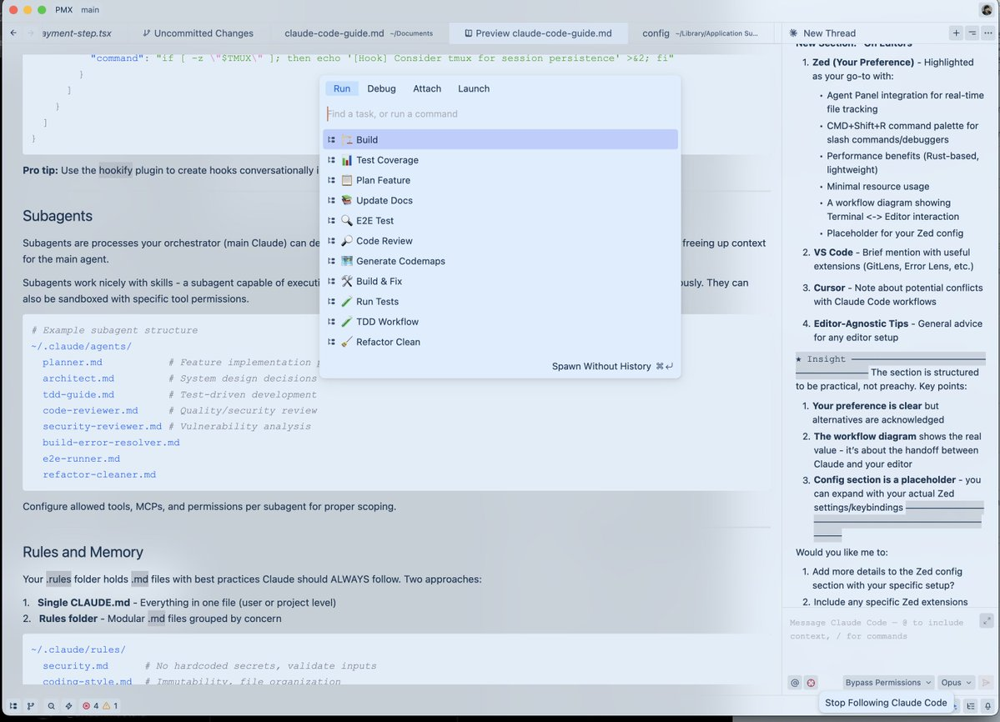
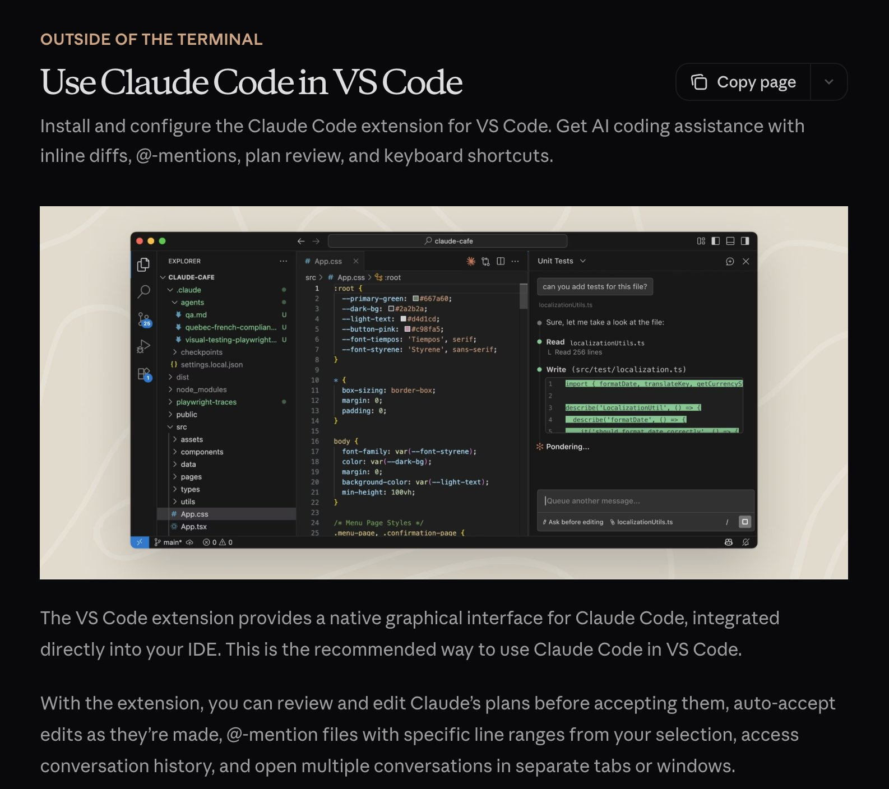
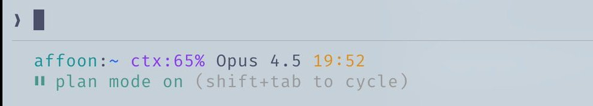

# ECC 简明指南

[English](the-shortform-guide.md) | [Português](the-shortform-guide.pt-BR.md) | **中文**



---

**从二月份实验性发布起我就是 Claude Code 的重度用户，并和 [@DRodriguezFX](https://x.com/DRodriguezFX) 一起完全用 Claude Code 做出了 [zenith.chat](https://zenith.chat)，赢得了 Anthropic x Forum Ventures 黑客松。**

下面是我每天使用 10 个月后的完整配置：技能、钩子、子代理、MCP、插件，以及真正好用的东西。

---

## 技能与命令

技能是定义工作流的主要方式。它们就像有范围的工作流包：可复用的提示词、结构、配套文件，以及在你
需要特定执行模式时使用的代码地图。

用 Opus 4.5 写了很久代码之后，想清理死代码和零散的 .md 文件？运行 `/refactor-clean`。需要测试？
`/tdd`、`/e2e`、`/test-coverage`。这些斜杠入口很方便，但真正长久的单元是它们背后的技能。技能
还可以包含代码地图——让 Claude 不用把上下文浪费在探索上，就能快速浏览你的代码库。


*把命令串联起来*

ECC 仍然带有 `commands/` 层，但最好把它看作迁移期间对旧斜杠入口的兼容。长期的逻辑应该放在技能里。

- **技能**：`~/.claude/skills/`——工作流的规范定义
- **命令**：`~/.claude/commands/`——仍需要时使用的旧斜杠入口垫片

```bash
# 技能结构示例
~/.claude/skills/
  pmx-guidelines.md      # 项目专用的模式
  coding-standards.md    # 语言最佳实践
  tdd-workflow/          # 含 SKILL.md 的多文件技能
  security-review/       # 基于检查清单的技能
```

---

## 钩子

钩子是在特定事件发生时触发的自动化。和技能不同，它们只作用于工具调用和生命周期事件。

**钩子类型：**

1. **PreToolUse**——工具执行前（校验、提醒）
2. **PostToolUse**——工具完成后（格式化、反馈循环）
3. **UserPromptSubmit**——你发送消息时
4. **Stop**——Claude 回复结束时
5. **PreCompact**——上下文压缩前
6. **Notification**——权限请求

**示例：在耗时命令前提醒使用 tmux**

```json
{
  "PreToolUse": [
    {
      "matcher": "tool == \"Bash\" && tool_input.command matches \"(npm|pnpm|yarn|cargo|pytest)\"",
      "hooks": [
        {
          "type": "command",
          "command": "if [ -z \"$TMUX\" ]; then echo '[Hook] Consider tmux for session persistence' >&2; fi"
        }
      ]
    }
  ]
}
```


*运行 PostToolUse 钩子时在 Claude Code 中看到的反馈示例*

**小技巧：**用 `hookify` 插件通过对话创建钩子，不用手写 JSON。运行 `/hookify`，然后描述你想要的。

---

## 子代理

子代理是编排者（主 Claude）可以委派有限范围任务的进程。它们可以在后台或前台运行，为主代理腾出
上下文。

子代理和技能配合得很好——能执行你部分技能的子代理可以接受委派任务，并自主使用这些技能。它们还
可以在沙箱中运行，只拥有特定的工具权限。

```bash
# 子代理结构示例
~/.claude/agents/
  planner.md           # 功能实现规划
  architect.md         # 系统设计决策
  tdd-guide.md         # 测试驱动开发
  code-reviewer.md     # 质量/安全评审
  security-reviewer.md # 漏洞分析
  build-error-resolver.md
  e2e-runner.md
  refactor-cleaner.md
```

为每个子代理配置允许的工具、MCP 和权限，控制好范围。

---

## 规则与记忆

你的 `.rules` 文件夹存放 Claude 必须**始终**遵守的最佳实践 `.md` 文件。有两种做法：

1. **单个 CLAUDE.md**——全部写在一个文件里（用户级或项目级）
2. **规则文件夹**——按主题拆分的模块化 `.md` 文件

```bash
~/.claude/rules/
  security.md      # 不硬编码密钥，校验输入
  coding-style.md  # 不可变性、文件组织
  testing.md       # TDD 工作流，80% 覆盖率
  git-workflow.md  # 提交格式、PR 流程
  agents.md        # 何时委派给子代理
  performance.md   # 模型选择、上下文管理
```

**规则示例：**

- 代码中不使用 emoji
- 前端避免使用紫色系
- 部署前一定要测试代码
- 优先写模块化代码，不要写巨型文件
- 绝不提交 console.log

---

## MCP（Model Context Protocol）

MCP 把 Claude 直接连接到外部服务。它不是 API 的替代品，而是包在 API 外面、由提示词驱动的一层，
让浏览信息更灵活。

**示例：**Supabase MCP 让 Claude 直接拉取特定数据、在源头运行 SQL，无需复制粘贴。数据库、部署
平台等也是如此。


*Supabase MCP 列出 public schema 中数据表的示例*

**Claude 中的 Chrome：**这是一个内置的插件 MCP，让 Claude 可以自主控制你的浏览器——点来点去看
东西是怎么运作的。

**关键：上下文窗口管理**

挑剔地选择 MCP。我把所有 MCP 都放在用户配置里，但**禁用所有不用的**。进入 `/plugins` 往下滚动，
或者运行 `/mcp`。


*用 /plugins 进入 MCP，查看当前安装了哪些以及它们的状态*

启用的工具太多时，你压缩前 200k 的上下文窗口可能只剩 70k。性能会明显下降。

**经验法则：**配置 20 到 30 个 MCP，但启用的不超过 10 个、活跃的工具不超过 80 个。

```bash
# 查看已启用的 MCP
/mcp

# 在 ~/.claude/settings.json 或当前仓库的 .mcp.json 中禁用不用的 MCP
```

---

## 插件

插件把工具打包起来，方便安装，免去繁琐的手动配置。一个插件可以是技能加 MCP 的组合，也可以是打包
在一起的钩子和工具。

**安装插件：**

```bash
# 添加插件市场
# @mixedbread-ai 的 mgrep 插件
claude plugin marketplace add https://github.com/mixedbread-ai/mgrep

# 打开 Claude，运行 /plugins，找到新的插件市场，从那里安装
```


*显示新安装的 Mixedbread-Grep 插件市场*

如果你经常在编辑器之外运行 Claude Code，**LSP 插件**特别有用。Language Server Protocol 让 Claude
无需打开 IDE 就能实时检查类型、跳转到定义并获得智能补全。

```bash
# 已启用插件示例
typescript-lsp@claude-plugins-official  # TypeScript 智能
pyright-lsp@claude-plugins-official     # Python 类型检查
hookify@claude-plugins-official         # 通过对话创建钩子
mgrep@Mixedbread-Grep                   # 比 ripgrep 更好的搜索
```

和 MCP 一样的提醒——注意你的上下文窗口。

---

## 技巧与窍门

### 快捷键

- `Ctrl+U`——删除整行（比狂按退格快）
- `!`——快速执行 bash 命令的前缀
- `@`——搜索文件
- `/`——开始输入斜杠命令
- `Shift+Enter`——多行输入
- `Tab`——切换思考过程的显示
- `Esc Esc`——打断 Claude / 恢复代码

### 并行工作流

- **Fork**（`/fork`）——分叉对话，并行处理互不重叠的任务，而不是一个劲地排队发消息
- **Git worktree**——让多个 Claude 并行处理有重叠的任务而不冲突。每个 worktree 都是独立的检出

```bash
git worktree add ../feature-branch feature-branch
# 现在在每个 worktree 中分别运行一个 Claude 实例
```

### 用 tmux 运行耗时命令

实时查看 Claude 运行的日志和 bash 进程：

[观看：tmux 会话实时显示一个耗时命令（视频）](./assets/images/shortform/07-tmux-video.mp4)

```bash
tmux new -s dev
# Claude 在这里运行命令，你可以随时分离和重新连接
tmux attach -t dev
```

### mgrep > grep

`mgrep` 比 ripgrep/grep 好用很多。通过插件市场安装，然后使用 `/mgrep` 技能。本地搜索和网页搜索
都支持。

```bash
mgrep "function handleSubmit"  # 本地搜索
mgrep --web "Next.js 15 app router changes"  # 网页搜索
```

### 其他有用的命令

- `/rewind`——回到之前的状态
- `/statusline`——自定义状态栏，显示分支、上下文百分比、待办
- `/checkpoints`——文件级的撤销点
- `/compact`——手动触发上下文压缩

### GitHub Actions CI/CD

用 GitHub Actions 为你的 PR 设置代码评审。配置好后，Claude 可以自动评审 PR。


*Claude 批准一个修复缺陷的 PR*

### 沙箱

有风险的操作请使用沙箱模式——Claude 在受限环境中运行，不会影响你真实的系统。

---

## 关于编辑器

编辑器的选择对 Claude Code 工作流影响很大。Claude Code 在任何终端里都能用，但搭配一个好用的编辑器，
可以实时跟踪文件、快速导航并集成执行命令。

### Zed（我的首选）

我用 [Zed](https://zed.dev)——它用 Rust 编写，所以是真的快。瞬间打开，处理超大代码库毫不费力，
几乎不占系统资源。

**为什么 Zed + Claude Code 是绝佳组合：**

- **速度**——Rust 的性能意味着 Claude 快速编辑文件时不会卡顿，编辑器跟得上
- **代理面板集成**——Zed 的 Claude 集成让你在 Claude 编辑时实时跟踪文件改动，不离开编辑器就能在
  Claude 提到的文件之间跳转
- **CMD+Shift+R 命令面板**——在可搜索的界面中快速访问所有自定义斜杠命令、调试器和构建脚本
- **资源占用极低**——繁重操作时不会和 Claude 抢 RAM/CPU，运行 Opus 时尤其重要
- **Vim 模式**——如果你喜欢，有完整的 vim 键位


*用 CMD+Shift+R 打开自定义命令下拉菜单的 Zed 编辑器。右下角的靶心图标表示跟随模式。*

**适用于任何编辑器的技巧：**

1. **分屏**——一边是运行 Claude Code 的终端，另一边是编辑器
2. **Ctrl + G**——在 Zed 中快速打开 Claude 当前正在处理的文件
3. **自动保存**——开启自动保存，让 Claude 读到的文件始终是最新的
4. **Git 集成**——提交前用编辑器的 git 功能评审 Claude 的改动
5. **文件监视**——大多数编辑器会自动重新加载被修改的文件，确认这个功能已开启

### VSCode / Cursor

这也是可行的选择，和 Claude Code 配合良好。你可以用终端形式，通过 `\ide` 与编辑器自动同步并启用
LSP 功能（现在与插件有些重复）；也可以选择扩展，它与编辑器集成得更紧密，界面也一致。


*VS Code 扩展为 Claude Code 提供原生图形界面，直接集成在 IDE 中。*

---

## 我的配置

### 插件

**已安装：**（我通常同时只启用其中 4 到 5 个）

```markdown
ralph-wiggum@claude-code-plugins       # 循环自动化
frontend-patterns@claude-code-plugins  # UI/UX 模式
commit-commands@claude-code-plugins    # Git 工作流
security-guidance@claude-code-plugins  # 安全检查
pr-review-toolkit@claude-code-plugins  # PR 自动化
typescript-lsp@claude-plugins-official # TS 智能
hookify@claude-plugins-official        # 创建钩子
code-simplifier@claude-plugins-official
feature-dev@claude-code-plugins
explanatory-output-style@claude-code-plugins
code-review@claude-code-plugins
context7@claude-plugins-official       # 实时文档
pyright-lsp@claude-plugins-official    # Python 类型
mgrep@Mixedbread-Grep                  # 更好的搜索
```

### MCP 服务器

**已配置（用户级）：**

```json
{
  "github": { "command": "npx", "args": ["-y", "@modelcontextprotocol/server-github"] },
  "firecrawl": { "command": "npx", "args": ["-y", "firecrawl-mcp"] },
  "supabase": {
    "command": "npx",
    "args": ["-y", "@supabase/mcp-server-supabase@latest", "--project-ref=YOUR_REF"]
  },
  "memory": { "command": "npx", "args": ["-y", "@modelcontextprotocol/server-memory"] },
  "sequential-thinking": {
    "command": "npx",
    "args": ["-y", "@modelcontextprotocol/server-sequential-thinking"]
  },
  "vercel": { "type": "http", "url": "https://mcp.vercel.com" },
  "railway": { "command": "npx", "args": ["-y", "@railway/mcp-server"] },
  "cloudflare-docs": { "type": "http", "url": "https://docs.mcp.cloudflare.com/mcp" },
  "cloudflare-workers-bindings": {
    "type": "http",
    "url": "https://bindings.mcp.cloudflare.com/mcp"
  },
  "clickhouse": { "type": "http", "url": "https://mcp.clickhouse.cloud/mcp" },
  "AbletonMCP": { "command": "uvx", "args": ["ableton-mcp"] },
  "magic": { "command": "npx", "args": ["-y", "@magicuidesign/mcp@latest"] }
}
```

关键就在这里——我配置了 14 个 MCP，但每个项目只启用大约 5 到 6 个，让上下文窗口保持健康。

### 关键钩子

```json
{
  "PreToolUse": [
    { "matcher": "npm|pnpm|yarn|cargo|pytest", "hooks": ["tmux reminder"] },
    { "matcher": "Write && .md file", "hooks": ["block unless README/CLAUDE"] },
    { "matcher": "git push", "hooks": ["open editor for review"] }
  ],
  "PostToolUse": [
    { "matcher": "Edit && .ts/.tsx/.js/.jsx", "hooks": ["prettier --write"] },
    { "matcher": "Edit && .ts/.tsx", "hooks": ["tsc --noEmit"] },
    { "matcher": "Edit", "hooks": ["grep console.log warning"] }
  ],
  "Stop": [
    { "matcher": "*", "hooks": ["check modified files for console.log"] }
  ]
}
```

### 自定义状态栏

显示用户、目录、带未提交标记的 git 分支、剩余上下文百分比、模型、时间和待办数量：


*在我 Mac 根目录下的状态栏示例*

```
affoon:~ ctx:65% Opus 4.5 19:52
▌▌ plan mode on (shift+tab to cycle)
```

### 规则结构

```
~/.claude/rules/
  security.md      # 强制的安全检查
  coding-style.md  # 不可变性、文件大小限制
  testing.md       # TDD，80% 覆盖率
  git-workflow.md  # Conventional commits
  agents.md        # 子代理委派规则
  patterns.md      # API 响应格式
  performance.md   # 模型选择（Haiku、Sonnet 还是 Opus）
  hooks.md         # 钩子文档
```

### 子代理

```
~/.claude/agents/
  planner.md           # 拆分功能
  architect.md         # 系统设计
  tdd-guide.md         # 先写测试
  code-reviewer.md     # 质量评审
  security-reviewer.md # 漏洞扫描
  build-error-resolver.md
  e2e-runner.md        # Playwright 测试
  refactor-cleaner.md  # 删除死代码
  doc-updater.md       # 保持文档同步
```

---

## 要点总结

1. **不要过度复杂化**——把配置当作微调，而不是架构
2. **上下文窗口很宝贵**——禁用不用的 MCP 和插件
3. **并行执行**——分叉对话，使用 git worktree
4. **把重复的工作自动化**——用钩子做格式化、lint 和提醒
5. **限制子代理的范围**——工具越少，执行越专注

---

## 参考资料

- [Plugins Reference](https://code.claude.com/docs/en/plugins-reference)
- [Hooks Documentation](https://code.claude.com/docs/en/hooks)
- [Checkpointing](https://code.claude.com/docs/en/checkpointing)
- [Interactive Mode](https://code.claude.com/docs/en/interactive-mode)
- [Memory System](https://code.claude.com/docs/en/memory)
- [Subagents](https://code.claude.com/docs/en/sub-agents)
- [MCP Overview](https://code.claude.com/docs/en/mcp)

---

**注意：**这里只是部分细节。高级模式请参阅[完整指南](./the-longform-guide.zh-CN.md)。

---

*在纽约与 [@DRodriguezFX](https://x.com/DRodriguezFX) 一起打造 [zenith.chat](https://zenith.chat)，赢得了 Anthropic x Forum Ventures 黑客松*
